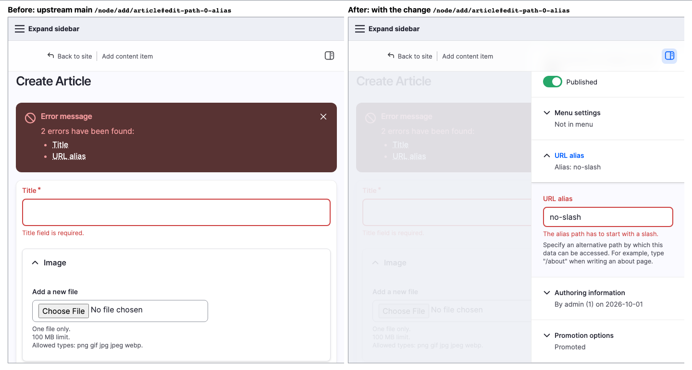

# Drupal Core Lab

**A reproducible testing environment for investigating Drupal Core issues, evaluating proposed fixes, and collecting evidence for the Drupal community.**

Drupal Core Lab helps contributors determine whether a proposed change fixes a problem without introducing new regressions.

It creates two comparable Drupal environments: one running the original code and another running the proposed change. Contributors can reproduce the problem, examine both implementations, run accessibility tests, and document the results.

Each experiment records enough information to repeat the evaluation against the same Drupal revision or a newer version of Drupal.

**[Explore the published Lab](https://mgifford.github.io/drupal-core-lab/)**

> **The published site is a read-only demonstration and issue guide.** Running interactive comparisons requires local DDEV environments or a supported cloud development workspace.

## See how it works



*Drupal issue [#3619127](https://www.drupal.org/project/drupal/issues/3619127): comparing form-error behaviour before and after a proposed change.*

The viewer allows contributors to inspect both Drupal environments under comparable conditions, reproduce interactions, and investigate differences.

[Watch the short animated demonstration](docs/images/viewer-demo.gif).

### Explore the project

- **[Where to focus](reports/issues/FOCUS.md):** The evaluated issues ranked by what would help most now: Needs review first, then RTBC, Needs work, watch and close-out.
- **[Browse evaluated issues](reports/issues/README.md):** Explore existing reproductions, patches, evidence, testing coverage, and issue status.
- **[Examine a worked example](reports/issues/3619127/REPRODUCE.md):** Follow the reproduction and evaluation of a Drupal form accessibility issue.
- **[Explore the published Lab](https://mgifford.github.io/drupal-core-lab/):** Review issue guides without installing Drupal.
- **[Run your first comparison](docs/FIRST-RUN.md):** Set up the Lab locally and reproduce an issue.

## What does Drupal Core Lab do?

### Reproduce Drupal issues

A useful issue report should make it possible for someone else to encounter the same problem.

The Lab captures the Drupal revision, relevant modules, themes, configuration, reproduction steps, and expected behaviour.

Drupal recipes and test fixtures help establish consistent conditions across experiments.

### Compare proposed changes

The Lab builds separate Before and After environments.

- **Before:** Drupal without the proposed fix.
- **After:** Drupal with the selected patch or merge-request changes applied.

Both environments should use equivalent configuration and content unless a difference is explicitly part of the experiment.

The Lab records the exact revisions and patch stack being evaluated.

This makes it possible to distinguish the effect of a proposed fix from unrelated changes in Drupal.

### Evaluate accessibility

The Lab supports several complementary testing methods:

- Playwright interactions and reproducible browser tests.
- axe-core accessibility checks.
- Keyboard and pointer interaction testing.
- Accessibility-tree and ARIA-state comparisons.
- Guidepup virtual screen-reader transcripts.
- Browser, viewport, colour-scheme, and forced-colours testing.
- Manual review and recorded observations.

These methods provide different forms of evidence.

**Automated tests and virtual screen-reader transcripts do not replace testing with people and assistive technologies.**

A passing test does not, by itself, establish WCAG conformance or prove that a proposed change is ready to merge.

See [Testing Tools](docs/TESTING-TOOLS.md) for the capabilities and limitations of each method.

### Investigate Drupal execution (optional)

A browser-only comparison can show that the page changed, but not which Drupal request produced it or whether the patch
added server-side work. An optional tracing layer connects Playwright actions and HTTP requests to Drupal's own
OpenTelemetry spans using W3C Trace Context, then adds a **Drupal execution evidence** section to the existing run report
and a hidden-when-unused tab to the viewer. It is off by default, needs no hosted service, and does not replace Playwright
traces, axe-core findings or Lighthouse reports. See [docs/observability/README.md](docs/observability/README.md) for the
worked #3619127 example and the limits of what a trace can prove.

### Investigate regressions

A proposed fix can improve one interaction while causing problems elsewhere.

The Lab helps contributors investigate unintended changes to focus behaviour, accessible names, announcements, presentation, component state, and other functionality.

Tests can be repeated against updated Drupal revisions or newer patch versions to determine whether earlier conclusions still hold.

### Preserve reproducible evidence

Each evaluated issue has its own directory under `reports/issues/`.

Depending on the investigation, records may include:

- A summary of the problem and proposed change.
- Reproduction steps and installation requirements.
- Patch files and exact source revisions.
- Screenshots, browser traces, and test results.
- Accessibility and manual review evidence.
- A record of tested and untested conditions.
- Issue status and outstanding questions.
- Draft comments for Drupal.org discussions.

Evidence is identified as draft until reviewed. Missing tests and inconclusive results remain visible rather than being reported as passes.

See [How results are organized](docs/RESULTS-LAYOUT.md).

## Resource use

The Lab records where AI tokens, estimated cost, CPU time, memory and GitHub Actions time are spent while an issue is
investigated. The measurements are deterministic, the local ledger stays out of Git, and the public dashboard contains
aggregates only. See [docs/RESOURCE-MONITORING.md](docs/RESOURCE-MONITORING.md) and the
[resource dashboard](https://mgifford.github.io/drupal-core-lab/resources.html).

## From investigation to contribution

Drupal Core Lab is intended to help people advance issues in the Drupal community.

A typical investigation involves reproducing the reported problem, evaluating a proposed change, checking for regressions, and preparing evidence that others can review.

The resulting documentation can support Drupal.org issue discussions, merge-request reviews, and further testing.

**The Lab does not automatically publish comments, patches, or test conclusions to Drupal.org.**

Contributors remain responsible for reviewing evidence and deciding what should be submitted upstream.

## Related projects

Drupal Core Lab has a distinct purpose within a broader collection of open-source quality tools.

- **[Drupal Quality Observatory](https://github.com/mgifford/drupal-core):** Examines accessibility, performance, sustainability, and quality across Drupal versions, configurations, and user journeys. Its long-term focus is recurring testing and historical reporting.
- **[Open Scans](https://github.com/mgifford/open-scans):** Runs multiple accessibility testing engines and compares findings, ACT mappings, and historical results.
- **[Firefox Energy Scanner](https://github.com/mgifford/firefox-energy-scanner):** Investigates browser activity, component behaviour, resource use, and energy measurements.

Drupal Core Lab concentrates on individual issues and proposed changes. It is not intended to duplicate the Observatory's broader monitoring and reporting responsibilities.

## Get involved

**Contributions are welcome from Drupal developers, accessibility specialists, designers, testers, and people who use Drupal.**

You can help by:

- Reproducing Drupal issues and confirming reported problems.
- Reviewing before-and-after comparisons.
- Providing keyboard and assistive technology testing evidence.
- Evaluating proposed patches and merge requests.
- Identifying regressions or unintended consequences.
- Improving recipes, automated tests, and reproduction instructions.
- Reviewing evidence and documenting unresolved questions.
- Improving the viewer, documentation, and testing infrastructure.

[Browse evaluated issues](reports/issues/README.md)

[Report a problem or suggest an improvement](https://github.com/mgifford/drupal-core-lab/issues)

[Learn how to start a new issue investigation](docs/NEW-ISSUE.md)

Contributors do not need to write code to help. Independent reproduction and manual verification are valuable contributions.

## Getting started locally

**You do not need to install Drupal to explore the published guides and evidence.**

Local development is intended for contributors who want to run the interactive viewer, evaluate patches, or develop the testing infrastructure.

You will need Docker, DDEV 1.24 or newer, Git, and Node.js 20 or newer. Some optional tools require newer Node.js versions.

First, review the [first-run guide](docs/FIRST-RUN.md), which covers installation and prerequisites.

From a configured checkout, the following commands build and start a worked comparison:

```bash
node scripts/doctor.mjs
node tools/compare/setup.mjs 3619127-pinned
node scripts/lab-env.mjs start 3619127-pinned
```

The setup creates the Before and After Drupal environments and prepares the viewer.

To stop the environments:

```bash
node scripts/lab-env.mjs stop 3619127-pinned
```

For more detailed instructions, consult the [viewer user guide](docs/USER-GUIDE.md).

### Cloud development

An optional workflow supports running the Lab in a [DDEV Coder](https://coder.ddev.com/) workspace without installing Docker locally.

The cloud integration is experimental. Some configurations and access scenarios have not been verified end to end.

See the [cloud development guide](docs/CLOUD-QUICKSTART.md) and its documented limitations.

## Project status and limitations

Drupal Core Lab is an active experimental project intended to support real contributions to Drupal Core.

Its capabilities include issue-specific environments, reproducible patch comparisons, browser testing, accessibility evidence, and historical issue records.

Important limitations include:

- The published GitHub Pages site is not a live Drupal testing environment.
- Automated accessibility tools cannot establish complete accessibility conformance.
- Guidepup virtual screen-reader output is not equivalent to a human screen-reader test.
- Some cloud workflows remain experimental.
- Reproduction steps and patches may require revision as Drupal changes.
- Evidence can become outdated when an upstream merge request changes.
- Results must identify what was tested, what was not tested, and what remains uncertain.

The goal is reproducible evidence that other contributors can evaluate, not automated declarations that an issue has been fixed.

## AI use

Generative AI is used to assist with development, documentation, issue investigation, test creation, and other maintenance activities.

AI-generated explanations, reproduction instructions, recipes, and proposed fixes may contain errors or omissions.

AI assistance does not establish that a patch is correct, secure, accessible, or suitable for inclusion in Drupal Core.

Evidence should be reproducible, independently reviewable, and clearly distinguished from unverified AI-generated conclusions.

Maintainers remain responsible for accepting changes and deciding what to contribute upstream.

See [AGENTS.md](AGENTS.md) for AI-assisted development requirements and [AI-LEARNING.md](AI-LEARNING.md) for documented development lessons.

## Documentation

Detailed guides and technical references are maintained separately from this introduction.

- [First-run guide](docs/FIRST-RUN.md)
- [Viewer user guide](docs/USER-GUIDE.md)
- [Starting a new issue](docs/NEW-ISSUE.md)
- [Issue packs and AI-assisted preparation](docs/ISSUE-PACK.md)
- [Testing tools and limitations](docs/TESTING-TOOLS.md)
- [Playwright and screen-reader testing](tools/playwright/README.md)
- [Viewer implementation and options](tools/compare/README.md)
- [Commands and configuration](docs/COMMANDS.md)
- [Environment management](docs/ENVIRONMENTS.md)
- [Issue lifecycle](docs/ISSUE-LIFECYCLE.md)
- [Results and evidence layout](docs/RESULTS-LAYOUT.md)
- [Accessibility requirements](ACCESSIBILITY.md)
- [AI agent instructions](AGENTS.md)
- [Technical reference](docs/TECHNICAL-REFERENCE.md)

## Relationship to Drupal

Drupal Core Lab is an independent testing and research project. It is not the canonical Drupal Core repository.

Drupal Core is developed by the international Drupal community.

- [Drupal.org](https://www.drupal.org/)
- [Drupal Core source repository](https://git.drupalcode.org/project/drupal)
- [Drupal Core issue queue](https://www.drupal.org/project/issues/drupal)
- [Contributing through issue forks and merge requests](https://www.drupal.org/drupalorg/docs/gitlab-integration/issue-forks-merge-requests)

The Lab exists to support that community by making problems easier to reproduce, proposed solutions easier to evaluate, and evidence easier to share.

## License

Drupal Core Lab is distributed under the [GNU General Public License, version 2 or later](LICENSE.txt), consistent with Drupal Core.

Third-party dependencies retain their respective licenses. Some inherited materials may have separate licensing requirements; consult their original sources before reuse.
