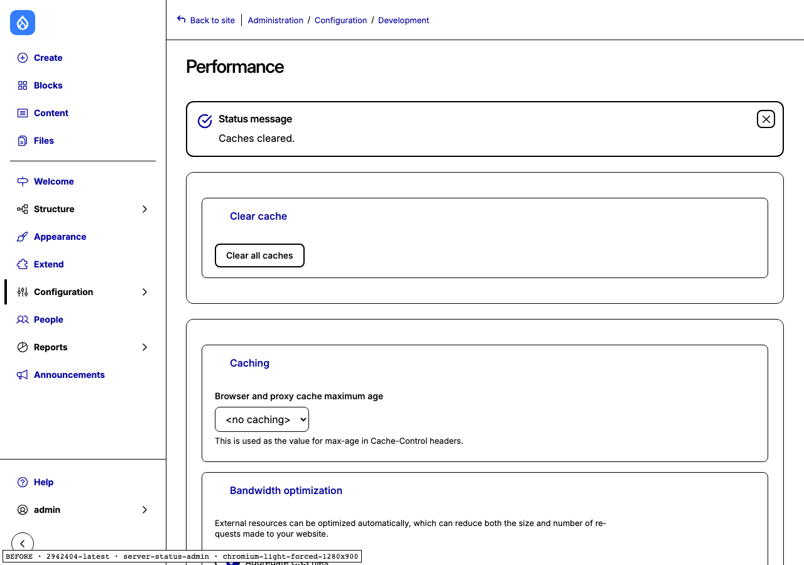
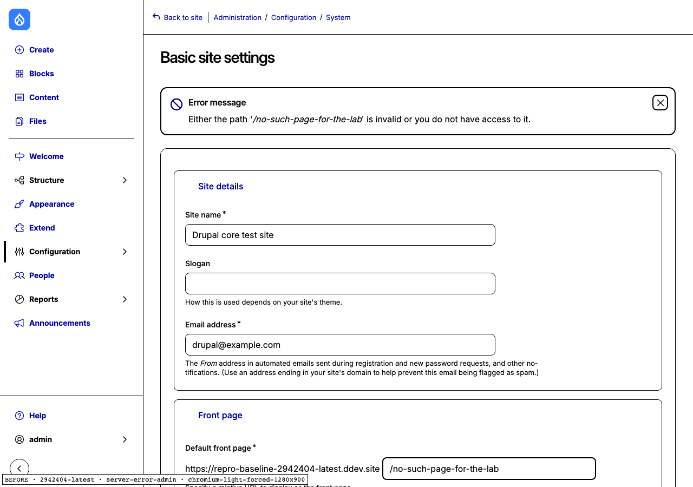
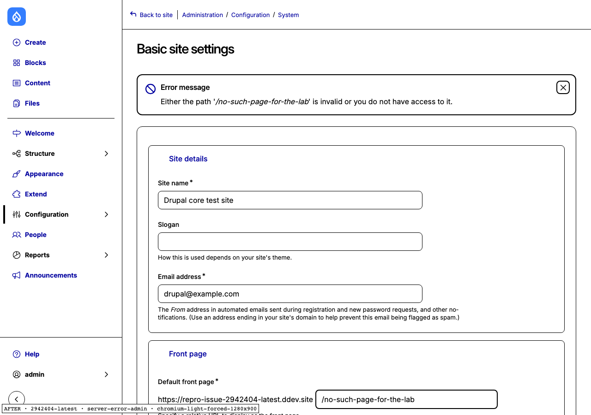
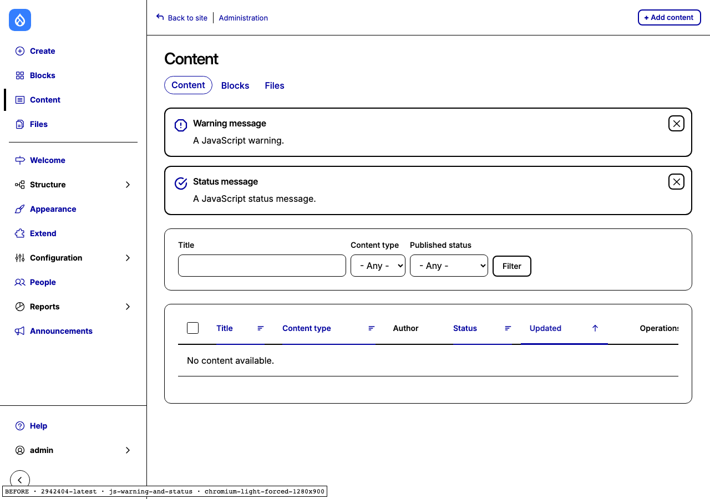
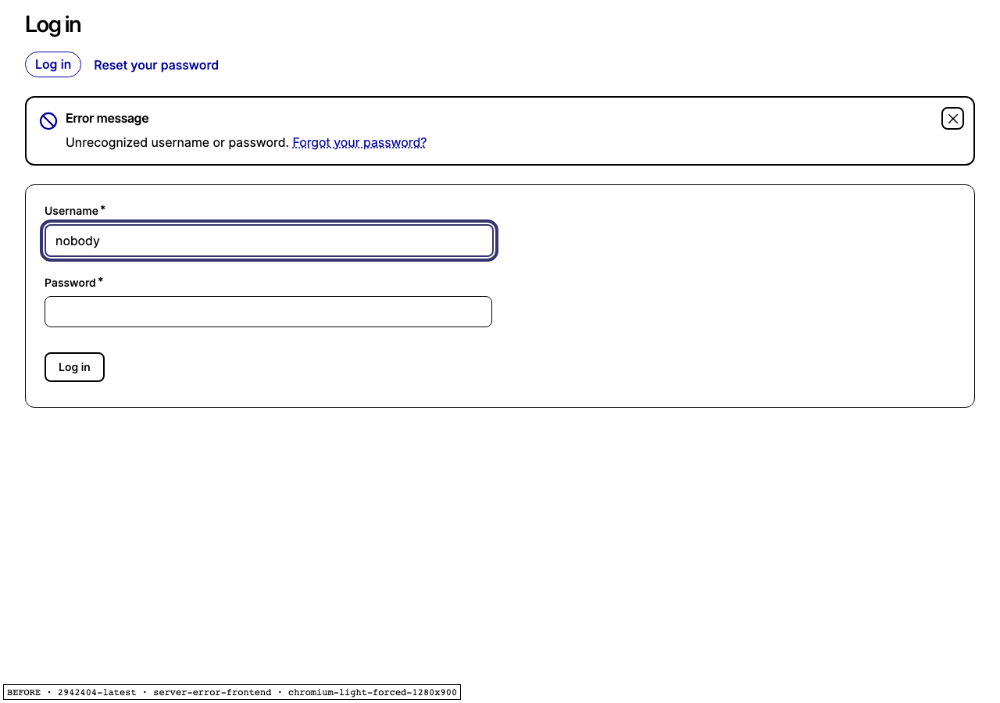
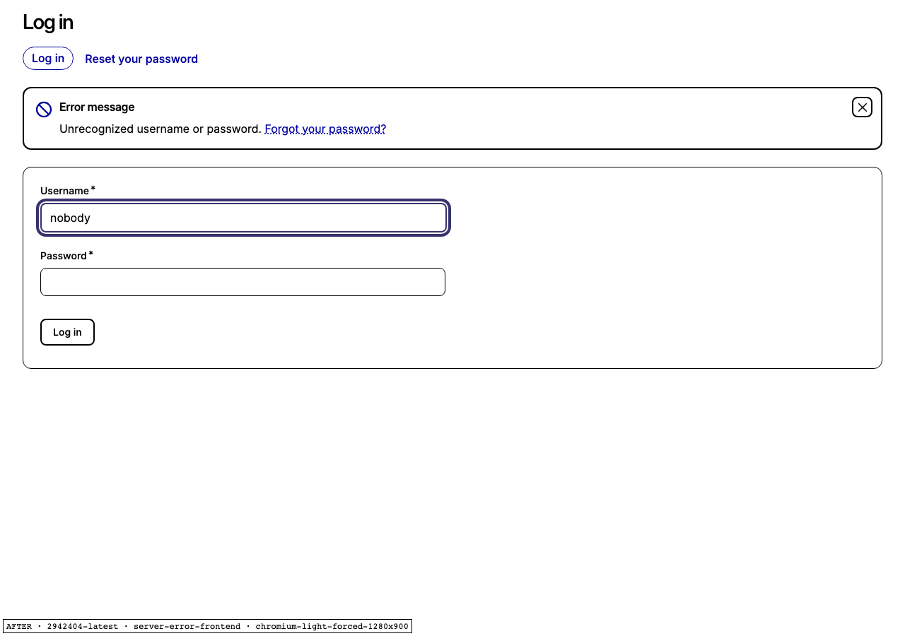

# #2942404 system messages: options on main

**Run:** `2026-11-19T20-37-42-698Z-chromium-light-forced-1280x900`  
**Configuration:** light OS scheme, forced colors, 1280x900 viewport  
**Comparison:** `2942404-latest` (#2942404: options for system messages on LATEST main (current main vs the MRs' region design))  
**Verdict recorded by the script:** not-reproduced (a draft; a person has not reviewed it)  
**Core commits:** Before 92e5c3a304 2026-11-18, After 92e5c3a304 2026-11-18  
**Browser:** chromium 156.0.8078.4, darwin arm64  

**Before and After:** Before is current core main: each message block is itself the live region (role=alert for error and warning, role=status for the rest), no landmark. After is main plus a lab-authored option that realigns the two old merge requests' design to main: a role=region landmark per message type with an inner role=alert (error) or role=status (status and warning). Templates only (system, Default Admin, starterkit); the old tests are deliberately left out. This is an option to compare, not a recommendation: main's design came from #3587678 and the MRs predate it.

Start with [SUMMARY.md](SUMMARY.md) for the measurements. The pictures below are the same states on both sides: **Before** is the left column, **After** is the right. Click an image to open it full size.

## Images

| State | Before | After |
|---|---|---|
| **server-status-admin**<br>Status message after "Clear all caches" (server-rendered, full-page redirect, admin theme) | [](before-server-status-admin.png) | [](after-server-status-admin.png) |
| **server-error-admin**<br>Error message on a form (server-rendered, admin theme; nothing is saved) | [](before-server-error-admin.png) | [](after-server-error-admin.png) |
| **js-warning-and-status**<br>Warning and status added by Drupal.Message (client-rendered; not changed by the option) | [](before-js-warning-and-status.png) | [](after-js-warning-and-status.png) |
| **server-error-frontend**<br>Error message after a wrong password (server-rendered, front-end theme, system template) | [](before-server-error-frontend.png) | [](after-server-error-frontend.png) |

Each image is the full page.

## Files in this folder

| File | What it is |
|---|---|
| `SUMMARY.md` | The run report: verdict, measurements and what was not tested. |
| `results.json` | The same results as data (environment, patch state, per-state measurements). |
| `ajax-before.json / ajax-after.json` | AJAX commands seen on each side during the run. |
| `before-*.png`, `after-*.png` | Screenshots from the unmodified (Before) and patched (After) site. |

## Download

On GitHub, open a file and choose the download button, or clone the repository. To fetch just this folder:

```
git clone --depth 1 --filter=blob:none --sparse https://github.com/mgifford/drupal-core-lab.git
cd drupal-core-lab
git sparse-checkout set reports/issues/2942404/playwright/2026-11-19T20-37-42-698Z-chromium-light-forced-1280x900
```

DRAFT, AI-assisted. Generated by `node scripts/run-readmes.mjs 2942404`; do not edit by hand.
