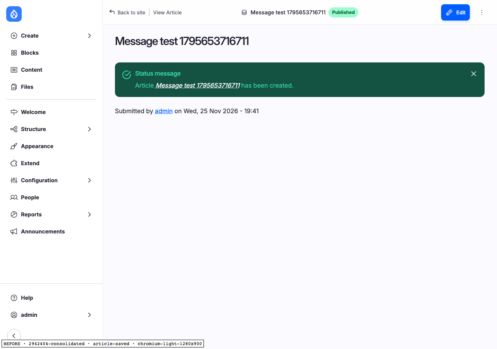
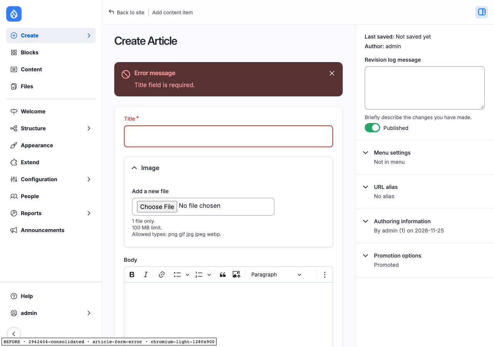
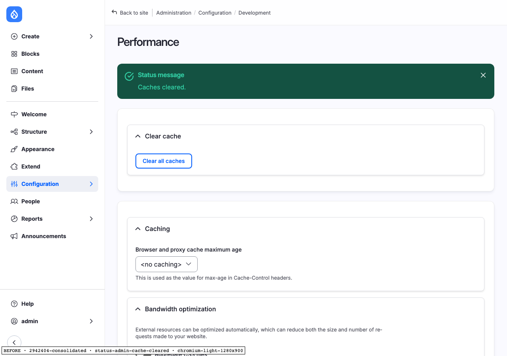
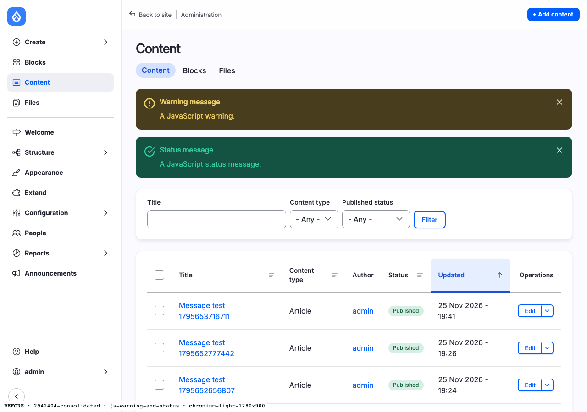
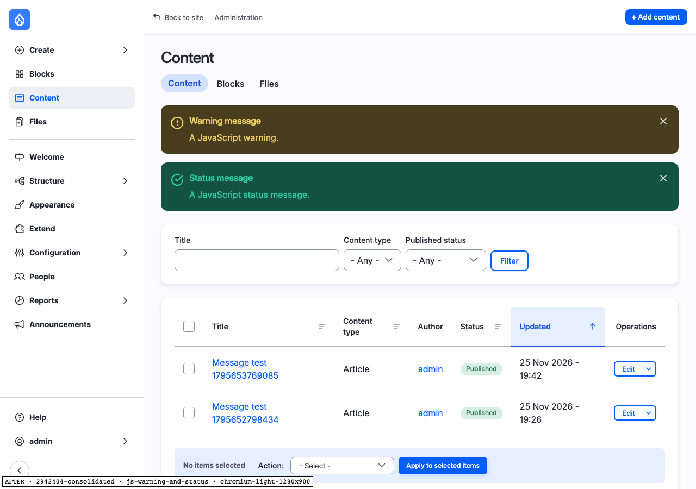
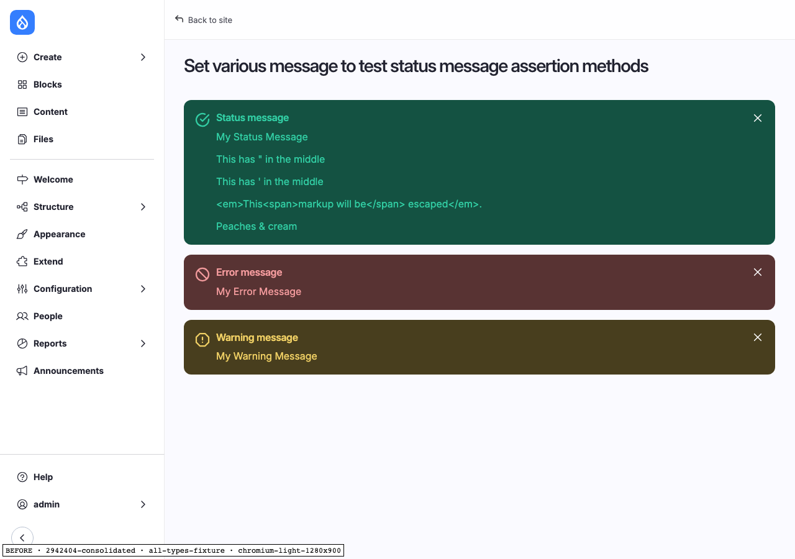
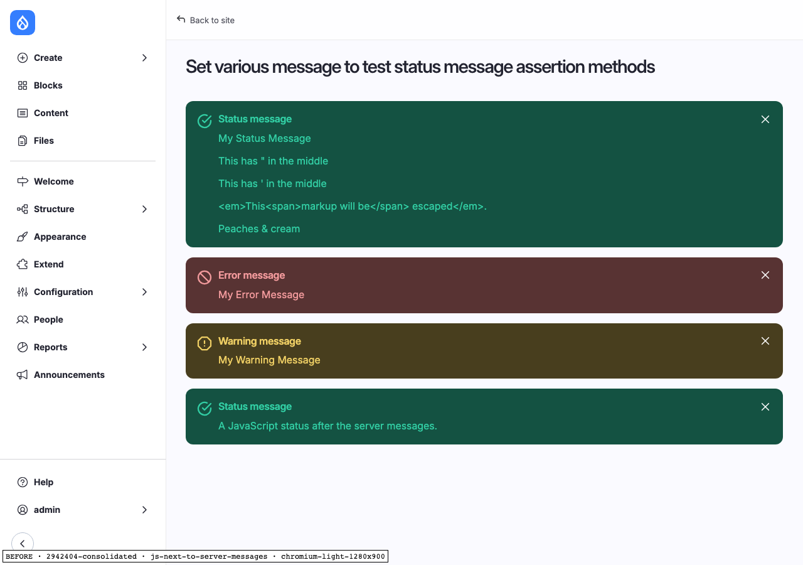
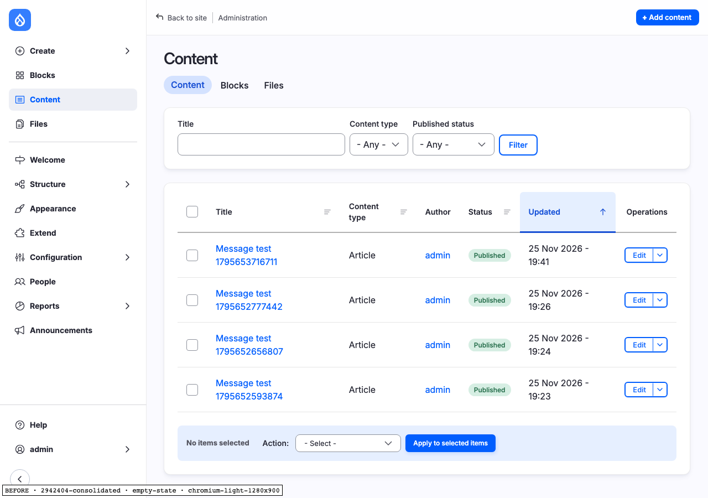
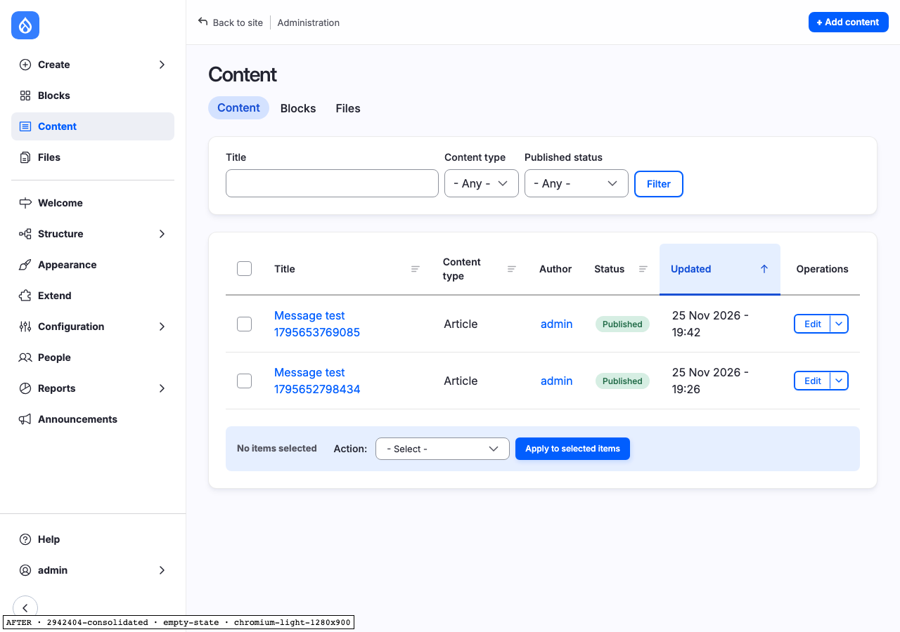
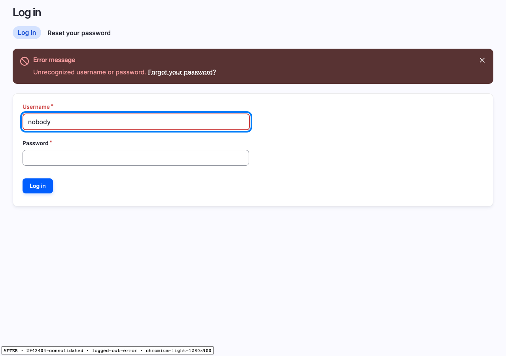

# #2942404 system messages: variant c

**Run:** `2026-11-26T00-41-15-177Z-chromium-light-1280x900`  
**Configuration:** light OS scheme, 1280x900 viewport  
**Comparison:** `2942404-consolidated` (#2942404: current main vs ONE consolidated "System messages" region (Variant C))  
**Verdict recorded by the script:** not-reproduced (a draft; a person has not reviewed it)  
**Core commits:** Before 0387fb94 2026-11-25, After 0387fb94 2026-11-25  
**Browser:** chromium 159.0.8154.6, darwin arm64  

**Before and After:** Before is current core main (Variant A, the same checkout as the 2942404-latest comparison). After is main plus a lab-authored option that wraps the message groups in ONE named landmark: the [data-drupal-messages] container becomes role=region with the accessible name 'System messages', and the existing per-type groups keep role=status (status) or role=alert (error and warning) and their headings. No nested live regions, no aria-live, no focus change. The template change covers system, Default Admin, starterkit, Umami and the test_messages test theme; Drupal.Message adds and removes the same landmark on default JavaScript messages and keeps contextual wrappers unchanged. Regression tests are included. Variant B (a region per type) is the 2942404-latest comparison. This is an option to evaluate, not a recommendation.

Start with [SUMMARY.md](SUMMARY.md) for the measurements. The pictures below are the same states on both sides: **Before** is the left column, **After** is the right. Click an image to open it full size.

## Images

| State | Before | After |
|---|---|---|
| **article-saved**<br>Status message after saving an Article (server-rendered, full-page redirect) | [](before-article-saved.png) | [](after-article-saved.png) |
| **article-form-error**<br>Error message on the Article form with an empty title (server-rendered) | [](before-article-form-error.png) | [](after-article-form-error.png) |
| **status-admin-cache-cleared**<br>Status message after "Clear all caches" (server-rendered, full-page redirect) | [](before-status-admin-cache-cleared.png) | [](after-status-admin-cache-cleared.png) |
| **js-warning-and-status**<br>Warning and status added by Drupal.Message on a page with no server messages (JavaScript only) | [](before-js-warning-and-status.png) | [](after-js-warning-and-status.png) |
| **all-types-fixture**<br>Status, warning and error together, with quotes, an ampersand and escaped markup (core system_test fixture; server-rendered warning) | [](before-all-types-fixture.png) | [](after-all-types-fixture.png) |
| **js-next-to-server-messages**<br>A JavaScript message added to a page that already shows server-rendered messages (containment) | [](before-js-next-to-server-messages.png) | [](after-js-next-to-server-messages.png) |
| **empty-state**<br>A page with no messages | [](before-empty-state.png) | [](after-empty-state.png) |
| **logged-out-error**<br>Error message after a wrong password while logged out (server-rendered) | [](before-logged-out-error.png) | [](after-logged-out-error.png) |

Each image is the full page.

## Files in this folder

| File | What it is |
|---|---|
| `SUMMARY.md` | The run report: verdict, measurements and what was not tested. |
| `results.json` | The same results as data (environment, patch state, per-state measurements). |
| `ajax-before.json / ajax-after.json` | AJAX commands seen on each side during the run. |
| `before-*.png`, `after-*.png` | Screenshots from the unmodified (Before) and patched (After) site. |

## Download

On GitHub, open a file and choose the download button, or clone the repository. To fetch just this folder:

```
git clone --depth 1 --filter=blob:none --sparse https://github.com/mgifford/drupal-core-lab.git
cd drupal-core-lab
git sparse-checkout set reports/issues/2942404/playwright/2026-11-26T00-41-15-177Z-chromium-light-1280x900
```

DRAFT, AI-assisted. Generated by `node scripts/run-readmes.mjs 2942404`; do not edit by hand.
