# #3426468 playwright evidence: #3426468

**Run:** `2026-11-26T13-51-44-305Z-webkit-light-1280x900`  
**Configuration:** light OS scheme, 1280x900 viewport  
**Comparison:** `3426468-latest` (#3426468: Make the active menu item visually stand out more (lab-authored fix, LATEST core main))  
**Verdict recorded by the script:** reproduced-and-fixed (a draft; a person has not reviewed it)  
**Core commits:** Before a48087f26ec 2026-11-26, After a48087f26ec 2026-11-26  
**Browser:** webkit 27.2, darwin arm64  

**Before and After:** Before: the active top-level item is colour and background only. After (v1+v2): a 4 px inline-start bar (the forced-colours idiom) plus the Default Admin gray-990 active colour. Measured 2026-11-26 on a48087f26ec in Chromium, Firefox and WebKit, light, dark, forced colours, collapsed, 480 px and RTL.

Start with [SUMMARY.md](SUMMARY.md) for the measurements. The pictures below are the same states on both sides: **Before** is the left column, **After** is the right. Click an image to open it full size.

## Images

| State | Before | After |
|---|---|---|
| **appearance-full** | [](before-appearance-full.png) | [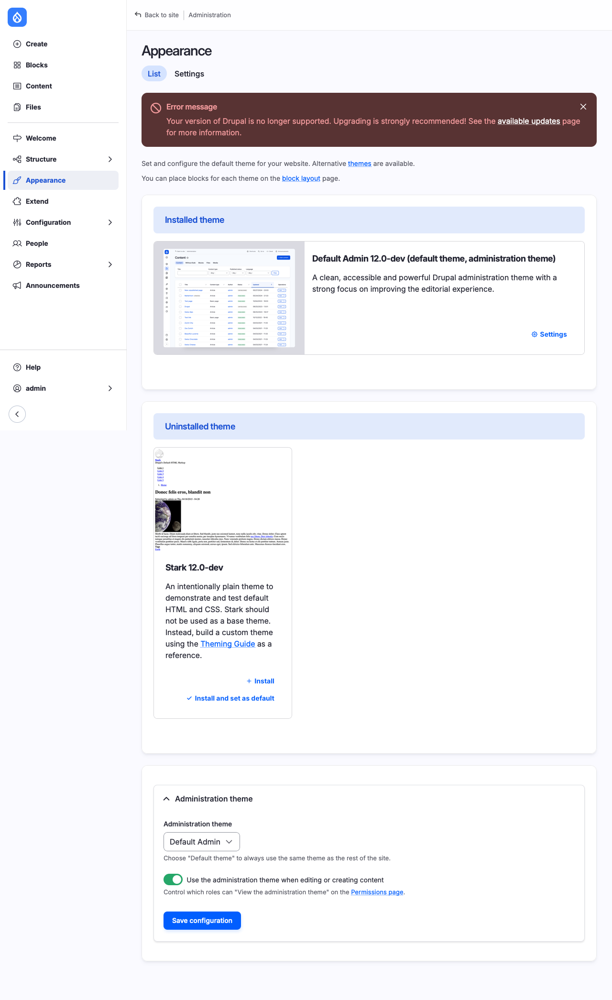](after-appearance-full.png) |
| **appearance-hover-nav** | [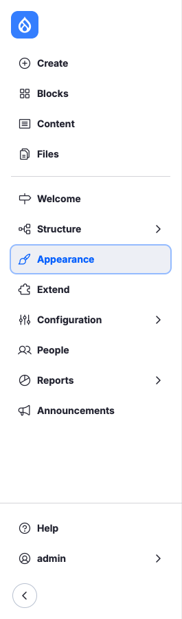](before-appearance-hover-nav.png) | [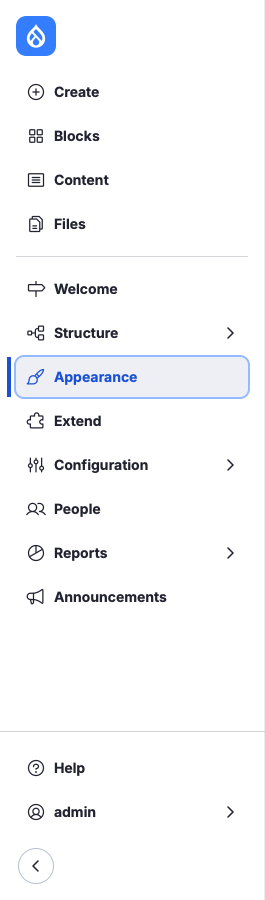](after-appearance-hover-nav.png) |
| **appearance-nav** | [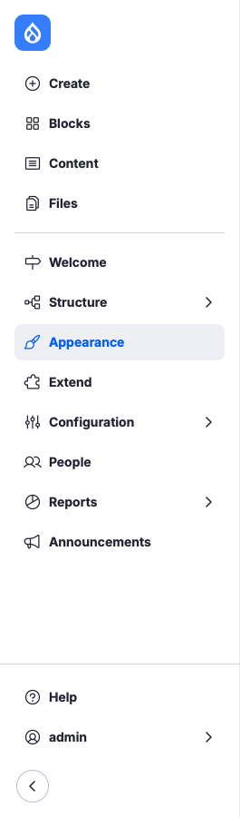](before-appearance-nav.png) | [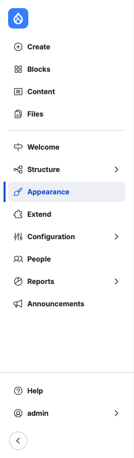](after-appearance-nav.png) |
| **content-full** | [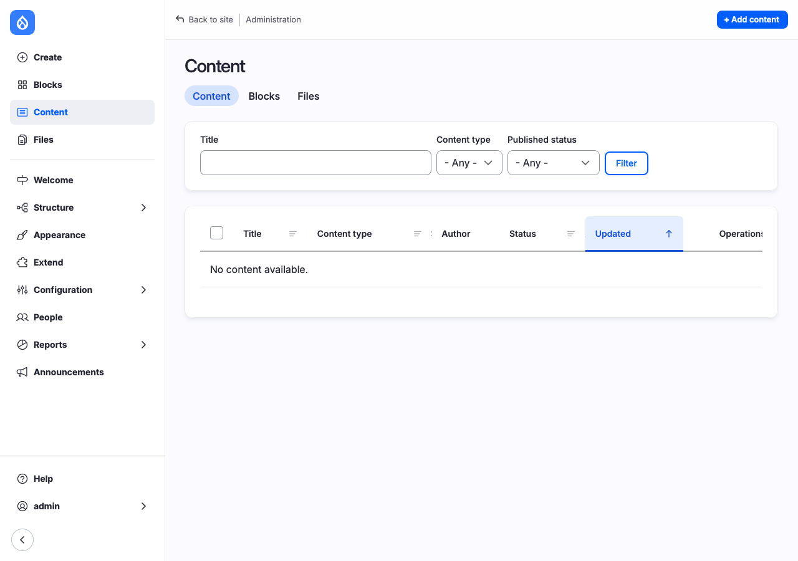](before-content-full.png) | [](after-content-full.png) |
| **content-hover-nav** | [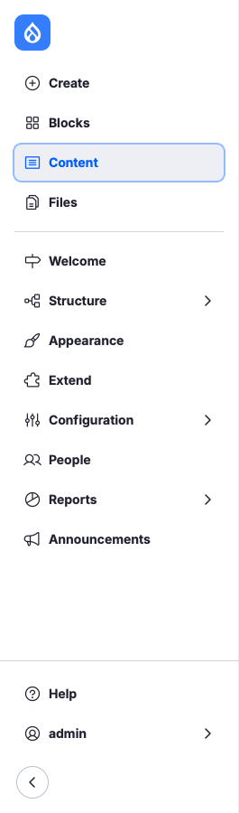](before-content-hover-nav.png) | [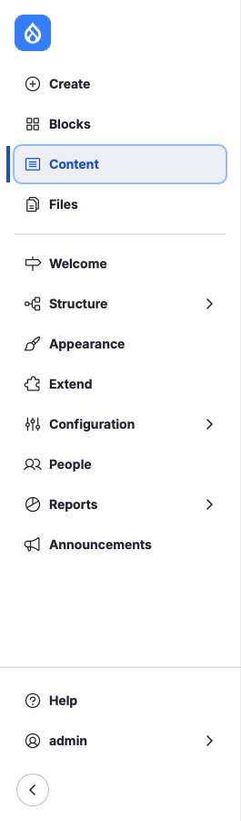](after-content-hover-nav.png) |
| **content-nav** | [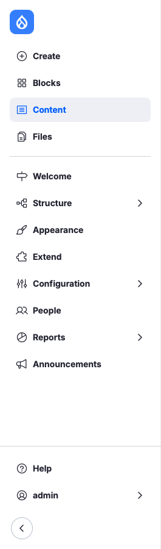](before-content-nav.png) | [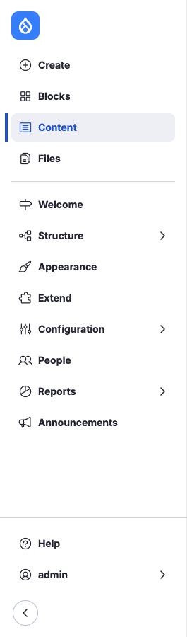](after-content-nav.png) |
| **form-modes-full** | [](before-form-modes-full.png) | [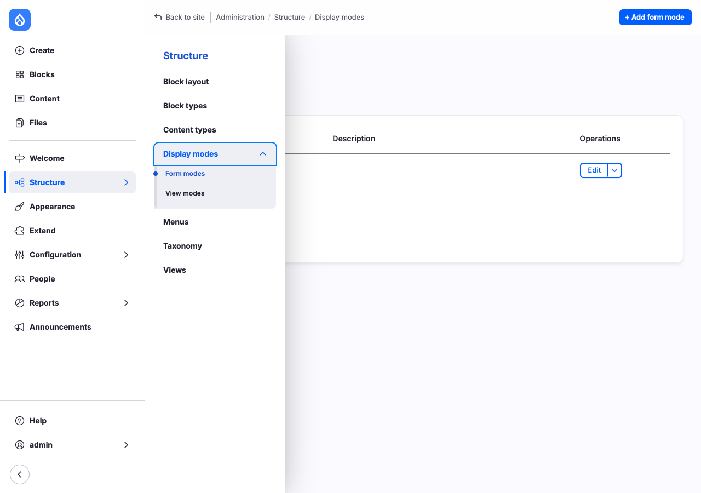](after-form-modes-full.png) |
| **form-modes-hover-nav** | [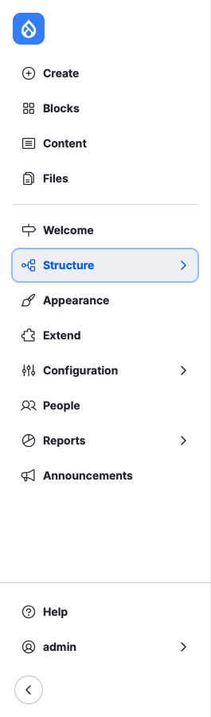](before-form-modes-hover-nav.png) | [](after-form-modes-hover-nav.png) |
| **form-modes-nav** | [](before-form-modes-nav.png) | [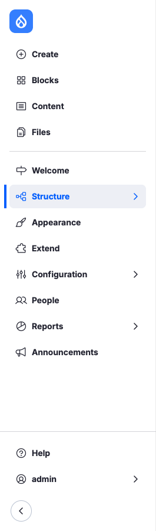](after-form-modes-nav.png) |

Each image is the full page.

## Files in this folder

| File | What it is |
|---|---|
| `SUMMARY.md` | The run report: verdict, measurements and what was not tested. |
| `results.json` | The same results as data (environment, patch state, per-state measurements). |
| `ajax-before.json / ajax-after.json` | AJAX commands seen on each side during the run. |
| `before-*.png`, `after-*.png` | Screenshots from the unmodified (Before) and patched (After) site. |

## Download

On GitHub, open a file and choose the download button, or clone the repository. To fetch just this folder:

```
git clone --depth 1 --filter=blob:none --sparse https://github.com/mgifford/drupal-core-lab.git
cd drupal-core-lab
git sparse-checkout set reports/issues/3426468/playwright/2026-11-26T13-51-44-305Z-webkit-light-1280x900
```

DRAFT, AI-assisted. Generated by `node scripts/run-readmes.mjs 3426468`; do not edit by hand.
