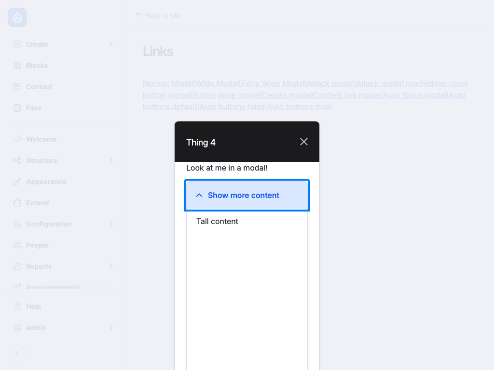
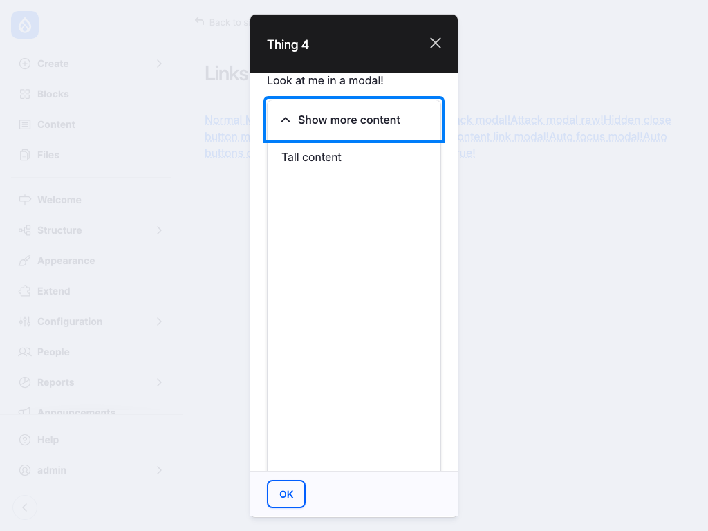

# Independent review: #3466040 / MR !9088

**DRAFT — AI-assisted independent review by Drupal Core Lab. Not a drupal.org post.**
No change was made to the merge request, its production code, or the issue status; the final decision remains with the independent human reviewer.

| | |
|---|---|
| Issue | [#3466040 Modal dialog does not adjust to increased inner height](https://www.drupal.org/project/drupal/issues/3466040) |
| Merge request | [!9088](https://git.drupalcode.org/project/drupal/-/merge_requests/9088) |
| Reviewed revision | `aed1df5eeddf0b89c91bab47eb83847f44c58211` |
| Base | `97c6ff8b2534b242c0f1df3e4ba2493e56aebcec` (2026-11-23) |
| MR patch | [`branches/3466040-dialog-buttoninputs-not.patch`](branches/3466040-dialog-buttoninputs-not.patch), sha256 `1adba92d…bfbfae8`, 4 files |
| Machine record | [`review.json`](review.json) (synchronised with this report) |
| Primary run | [`playwright/2026-11-27T16-43-04-546Z-chromium-light-1024x768-fixture/`](playwright/2026-11-27T16-43-04-546Z-chromium-light-1024x768-fixture/SUMMARY.md) |

## Bottom line

- **The original problem is reproduced** with the MR's own fixture on pristine core: the dialog grows to `729px` tall from a `265px` dialog and ends `212.3px` below a `768px` viewport. The content area scrolls, but the button pane and its OK button do not: the OK button is at `y 926.3–967.3` and is not hit-testable. A manual run at `1280x1080` reproduced `353.3px` of overflow.
- **The MR fixes that fixture**: the same expansion gives `top 19.5`, `bottom 748.5`, `0px` overflow; the button pane (`681.5–747.5`) and OK button (`694.5–735.5`) are in view and hit-testable. The content still scrolls (`578/2146`).
- **The observer lifecycle is clean in this run**: one observer per dialog, one callback and one `resetSize` per expansion, zero callbacks while idle, disconnect on close, four opens produced four observers and four disconnects, zero callbacks or events after close, and zero page errors when the dialog is closed immediately after an expansion.
- **No confirmed regression.** Views UI and Field UI dialogs are geometrically unchanged; axe reports 0 violations in the expanded fixture on both sides; console and page errors are 0.
- **The issue's listed real-world steps did not reproduce on this core revision in the tested viewports.** Views UI already sizes an inner scroll container and absorbs details expansion; the Field UI config dialog at 1080px is already at its 95% cap and scrolls internally. The fixture is the only confirmed reproduction in this review.
- **The regression test fails without the production change and passes with it**, by CI and by independent evaluation of the same assertion against the measured rectangles. Its assertions are weaker than the claim: it can pass when the details did not open, and when the content is clipped rather than scrollable.
- **Not tested**: the zoom/reflow matrix, 480/320px viewports, dark/forced-colours/reduced-motion, real browser zoom, a person's keyboard pass, a real screen reader, other browsers, and a local PHPUnit run. Docker Desktop stopped under host memory pressure before those runs; the runner is written and the gap is recorded below.

**Recommended status: Needs review — not RTBC on this evidence.** The code is confirmed for the fixture and shows no regression; test hardening and the unverified configuration/AT matrix should be resolved, or explicitly accepted by the maintainers, before RTBC.

## What was reviewed, and the independence of the comparison

The review used the Lab's existing `3466040` environments and recipe. Both sides are the same core commit, the same Drupal (`12.0-dev`), PHP (`8.5.7`), `standard` profile, `default_admin` theme (dark mode auto, high contrast off), the same modules and the same `repro_3466040` recipe (Article content type, French, Config Translation).

| Side | Environment | Core | Patches |
|---|---|---|---|
| Before | `baseline-3466040` | `97c6ff8b25` (2026-11-23) | [`3466040-test-support.patch`](branches/3466040-test-support.patch), sha256 `262dd0fc…674222` — the MR's three test/fixture hunks only |
| After | `issue-3466040` | `97c6ff8b25` (2026-11-23) | the full MR patch, above |

The Before side is pristine core except for the declared test-support fixture. That fixture is required to test the MR's own modal on both sides: the route, controller method, link and test are identical files on both sides, and the only production difference between the environments is `core/misc/dialog/dialog.position.js`. This is the Lab's declared test-support pattern (variant `3466040-regression-pinned`), not a modification of the change under test.

**Residual state:** `baseline-3466040` currently holds that test-support patch. Revert it before using the pristine `3466040-pinned` variant: `node tools/compare/setup.mjs 3466040-pinned --refresh-patches`.

## Reproduction

### The MR fixture

Preconditions: test-extension discovery is enabled and `dialog_renderer_test` is installed on both sites; the Before site has the test-support patch and the After site has the MR. Log in as an administrator.

1. Go to `/dialog_renderer-test-links`.
2. Click **Details modal!** (`a[href="/dialog_renderer-content-details"]`). Wait for `.ui-dialog`.
3. It is a short dialog: `302 x 265.4`, `top 251.3`, `bottom 516.7` at `1024x768`, with OK in view.
4. Click **Show more content** (`.ui-dialog details summary`). This reveals a 2000px block.
5. Measure `.ui-dialog`, `.ui-dialog-content`, `.ui-dialog-buttonpane` and `.ui-dialog-buttonpane button`.

| Measurement, `1024x768` | Before | After |
|---|---|---|
| Dialog rect after the expansion | `top 251.3`, `bottom 980.3`, height `729` | `top 19.5`, `bottom 748.5`, height `729` |
| Fits the viewport | **no** | **yes** |
| Overflow below the viewport | **212.3px** | **0px** |
| Content area | `578` client / `2146` scroll, `overflow-y: auto` | same |
| Button pane | `913.3–979.3`, **outside the viewport**, not hittable | `681.5–747.5`, in view, hittable |
| OK button | `926.3–967.3`, **outside the viewport**, not hittable | `694.5–735.5`, in view, hit-testable |
| Titlebar | `252.3–335.7`, in view | `20.5–103.9`, in view |
| Close button | in view, hittable | in view, hittable |





The manual confirmation at `1280x1080` (Playwright MCP Chrome) gave the same result: Before `top 407.3`, `bottom 1433.3`, `353.3px` overflow, OK at `y 1379.3`; After `top 27`, `bottom 1053`, no overflow, OK at `y 999`. The close button stayed visible in both.

### The issue's other steps

| Scenario | Result on this revision |
|---|---|
| **Views**: `/admin/structure/views/view/content` → "Content: Content type" → expand details ([run](playwright/2026-11-27T16-24-50-391Z-chromium-light-1920x1080/SUMMARY.md)) | **Does not reproduce.** Views UI's `dialog.views.js` already sizes `[data-drupal-views-scroll]` to the dialog and dispatches `dialogContentResize` on summary clicks. The dialog stays `845.4px` tall (`121.3→966.7` Before, `117.3→962.7` After, a 4px re-centring), the inner container scrolls (`689/960`), and nothing leaves the viewport. The evaluator's automated toggle loop did not click (no B2 stages); a manual MCP click on "Style settings" confirmed the unchanged dialog height and the inner scroll. |
| **Field UI**: Article → Manage fields → Add a Date and time field → field config → "Set default value" ([run](playwright/2026-11-27T15-35-43-499Z-chromium-light-1920x1080/SUMMARY.md)) | **Does not reproduce at 1920x1080.** The config modal is already `1026px` tall, exactly 95% of 1080, before the growth; the content area absorbs it (`878/1272`) and the button pane stays in view on both sides. This is the issue's "with a small viewport the problem does not happen" condition: at this height the dialog is at its cap from the start. A taller viewport where the dialog opens short is an untested hypothesis, not a finding. |
| **Media library + `image_widget_crop`**, multilingual Views translation (comment #24) | Not tested; the fixture does not include these flows. |

This matters for the issue: the generic fix is exercised by the fixture, but the originally listed Views path is already mitigated by a Views-specific workaround, and the Field UI path needs a viewport where the dialog opens short. A reviewer should know which user path the fix is expected to change in practice.

## Keyboard, focus and reachability

The Tab walk used real key presses from the focused summary, after the content had been scrolled to its bottom (so the summary itself is out of view at step 0; the action is the step that matters).

| Step | Before | After |
|---|---|---|
| Tab presses to the primary action | 1 | 1 |
| Focused element | `button.ui-button "OK"` | `button.ui-button "OK"` |
| In the viewport when focused | **no** | **yes** |
| Hit-testable when focused | **no** | **yes** |
| Page scrolled to reveal it | no | no |
| Dialog content scrolled | n/a (the button is outside the content) | n/a |

On Before the focus leaves the visible dialog: the dialog is fixed-position and its button pane is not inside the scrollable content, so the browser cannot scroll it into view. That is a confirmed focus-visibility barrier, not a keyboard trap — Escape and the close button remain available, and the button can still be activated with Enter by a keyboard user who knows it is there.

axe-core (WCAG 2.0–2.2 A/AA) reported **0 violations** in the expanded fixture on both sides. axe does not test geometry or focus visibility; it says nothing about this barrier.

## ResizeObserver analysis

Instrumentation is page-level only: `window.ResizeObserver` is subclassed pass-through before page scripts, the patch's observer is discovered from `jQuery(.ui-dialog-content).data("drupalAutoResizeObserver")`, and `dialogContentResize` is captured in the capture phase. No environment or MR file was changed.

| Measure | Before | After |
|---|---|---|
| Patch observer exists | no | yes |
| Observer callbacks during the expansion | 0 | **1** |
| `dialogContentResize` from `.ui-dialog-content` during the expansion (i.e. `resetSize` ran) | 0 | **1** |
| Callbacks in the 800ms idle window after settling | 0 | **0** |
| Per expand+collapse cycle | 0 | 2 callbacks, 2 `resetSize` events |
| Dialog bottom over five cycles | expanded `980.3`, collapsed `516.7` every time | expanded `748.5`, collapsed `516.7` every time |
| Observer disconnected on close | n/a | yes (1 of 1) |
| Callbacks / events in the 900ms after close | 0 / 0 | **0 / 0** |
| Opens tested (initial + 3 re-opens) | 4 | 4 |
| Patch observers created / disconnected | 0 / 0 | **4 / 4** |
| Immediate expand-then-Escape (3 trials): page errors | 0 | **0** |
| Page / console errors in all stages | 0 | 0 |

**It settles.** One callback per expansion is enough at this viewport; the observer sees its own `resetSize` change the content box once and then goes quiet. There is no growth, drift or oscillation over five cycles, and no `ResizeObserver loop completed with undelivered notifications` page error.

**Teardown works.** The run's `F6-closed` table charges the five cycles' resets to that stage because the probe version had no separate post-cycle stage; the dedicated 900 ms after-close window is the measurement that matters. `dialog:beforeclose` cancels the debounced function and disconnects the observer. Closing immediately after an expansion (inside the 20ms debounce window) produced no callback, no `dialogContentResize` and no page error in three trials. Four AJAX opens created four observers and disconnected all four.

**One measurement limitation:** the debounced `autoResize` that the observer calls is a closure, so wrapping `data("drupalAutoResize")` cannot count observer-triggered calls. The `autoResize` counter in earlier lab notes is therefore 0 even while the fix runs. `dialogContentResize` dispatched on `.ui-dialog-content` is the reliable proxy for "`resetSize` ran"; this report uses that, not the `autoResize` counter.

### Component-level configurations

These used `Drupal.dialog()` with `showModal()`/`show()` and real clicks; they are component evidence, not a core user flow.

| Case | Before | After |
|---|---|---|
| Explicit `height: 300` | `300px`, fits, content `149/1309` scrolls, OK in view | same; observer exists, 0 callbacks (the content box has a fixed height) |
| Explicit `maxHeight: 400` | `400px`, fits, content `249/1309` scrolls, OK in view | same; observer fires once, no viewport change |
| `autoResize: false` (control) | grows to `1460.1px`, `946px` overflow, OK off-screen | same, no observer — opted out by design; the MR does not claim to fix this path |
| Two non-modal `Drupal.dialog()`s, grow one | grown dialog `top 120 → bottom 849` (`81px` overflow), other unchanged | grown dialog re-centred `19.5 → 748.5`, other unchanged; both observers present |

Two simultaneous core **AJAX modal** dialogs are not supported (core reuses `#drupal-modal`); only two `Drupal.dialog()` instances were tested.

### Fractional pixels and #3458272

[#3458272](https://www.drupal.org/project/drupal/issues/3458272) ("Subpixel rounding issue causes dialog to resize unnecessarily") is **already fixed in this base**: `dialog.position.js` rounds `event.data.$element.parent().outerHeight()` before comparing it to the pixel `maxHeight`, which is the change that issue committed. The patch under review adds a different feedback edge — the observer watches the content box that `resetSize` itself changes.

In this run that edge converged: one callback, one reset, no loop, no oscillation, and no fractional growth over five cycles. The new test's boundary `rect.bottom <= window.innerHeight` has no sub-pixel tolerance; at `1024x768` the corrected dialog has `19.5px` of headroom, so a fraction of a pixel is not a practical risk here. At a much smaller effective viewport (400% zoom) the headroom scales to about 2.5% of the viewport height; that case was not measured. **Theoretical concern only, not a confirmed defect.**

A second theoretical concern: calling `show()`/`showModal()` twice on the same `Drupal.dialog` object without closing would create a second observer, overwrite the stored one and leak the first. Core AJAX opens create a new element each time and the four-open test showed no leak; this is not observed in a core flow.

## Regression test

`Drupal\Tests\system\FunctionalJavascript\ModalRendererTest::testModalContentGrows` (`core/modules/system/tests/src/FunctionalJavascript/ModalRendererTest.php:170-189`).

**Without the production change it fails; with it, it passes.** Two independent lines of evidence:

1. **CI.** Pipeline [1063751](https://git.drupalcode.org/issue/drupal-3466040/-/pipelines/1063751) passed. Its `Test-only changes` job (`13926147`) reverts the non-test change and runs the changed tests; its log reports `Tests: 3, Assertions: 49, Failures: 1`, with `testModalContentGrows` failing at line 183 on the `assertJsCondition` ("Failed asserting that false is true"). The pipeline's three PHPUnit Functional Javascript jobs passed with the change. Log: [`ci/gitlab-job-13926147-test-only-changes.log`](ci/gitlab-job-13926147-test-only-changes.log).
2. **Independent assertion evaluation.** The assertion is `rect.top >= 0 && rect.bottom <= window.innerHeight`. The measured `rect.bottom` in the same fixture at the same `1024x768` viewport is `980.3` on Before (false) and `748.5` on After (true). Same fixture, same assertion, same viewport.

**Not run locally.** Docker Desktop stopped under host memory pressure (16GB host, load 25–73 from other Lab environments) before `ddev phpunit --filter testModalContentGrows` could run. The CI job is real test execution, but it is not this reviewer's independent local run; record that distinction.

**The test's assertions are weaker than its name suggests.** These are test-quality gaps, not defects in the production fix:

- It never asserts that the details element opened. A click that does nothing, or a fixture shipped with `#open => TRUE`, leaves the dialog short and the test passes.
- It never asserts that the content area scrolls. A "fix" that clipped the content (`overflow: hidden`) could keep the dialog short and pass the geometry checks while making the tall content unreachable.
- The titlebar assertion is not discriminating: on pristine core the titlebar is at the top of the still-centred dialog and passes while the button pane is off-screen.
- No AJAX growth into an already open dialog, which the author says is not fixed ("works only for some use-cases. Not for ajax stuff", comment #32).
- One implicit viewport, no `autoResize: false`, no explicit height/maxHeight, and a boundary with no sub-pixel tolerance.

Suggested hardening (a proposal for the MR, **not applied**): assert `details.open === false` before the click and `true` after it, and assert `content.scrollHeight > content.clientHeight` with `overflow-y: auto|scroll` after the dialog settles. The Lab's earlier [`reviews/test-review.md`](reviews/test-review.md) §6 has the exact diff.

## WCAG implications

The barrier, stated first: after content grows inside a modal dialog, the action buttons move below the viewport; the content area scrolls but the button pane does not, so a pointer user cannot activate the action, and a sighted keyboard user's focus moves to a control that is not visible anywhere on screen.

| Criterion | Level | Relationship | Basis |
|---|---|---|---|
| [2.4.7 Focus Visible](https://www.w3.org/WAI/WCAG22/Understanding/focus-visible.html) | AA | **Confirmed failure on Before** | One Tab focuses OK at `y 926.3` in a `768px` viewport; no scroll occurs and the fixed dialog cannot bring its button pane into view. |
| [2.4.11 Focus Not Obscured (Minimum)](https://www.w3.org/WAI/WCAG22/Understanding/focus-not-obscured-minimum.html) | AA (WCAG 2.2) | **Confirmed failure on Before** | The focused action is entirely outside the viewport; After moves it to `694.5–735.5`. |
| [2.1.1 Keyboard](https://www.w3.org/WAI/WCAG22/Understanding/keyboard.html) | A | Not a failure | The button is reachable and activatable by keyboard; Escape and the close button remain available, so this is not a keyboard trap. |
| [1.4.10 Reflow](https://www.w3.org/WAI/WCAG22/Understanding/reflow.html) | AA | Risk, **not verified** | Needs 320 CSS px width / 400% zoom; the configuration matrix could not run. |
| [1.4.4 Resize Text](https://www.w3.org/WAI/WCAG22/Understanding/resize-text.html) | AA | Risk, **not verified** | 200% zoom / text-only enlargement was not run. |
| [2.4.3 Focus Order](https://www.w3.org/WAI/WCAG22/Understanding/focus-order.html) | A | Unchanged | The Tab order is the same on both sides; only the visibility of the focused control changes. |

These are implications of measured geometry and a Tab walk in Chromium, not a conformance conclusion for Drupal core. No testing with disabled people was done.

## Confirmed defects, theoretical concerns, regressions

**Confirmed (product, Before):** growing dialog content beyond the initially calculated max-height moves the button pane outside the viewport; the content scrolls but the pane does not; pointer activation is impossible and keyboard focus becomes invisible. Confirmed at `1024x768` (212.3px) and manually at `1280x1080` (353.3px).

**Confirmed (test quality, MR):** `testModalContentGrows` can pass without the details opening and without the content scrolling; the titlebar assertion cannot fail on pristine core.

**Theoretical, not confirmed:** observer leak on repeated `show()` without close; sub-pixel interaction with #3458272; AJAX insertion into an already-open dialog; growth outside the content element; `autoResize:false` dialogs still overflow (confirmed but by design and out of scope).

**Confirmed regressions: none** in the tested scenarios. Views and Field UI dialog dimensions are unchanged; axe is 0 on both sides; keyboard order is unchanged; no console or page errors.

## Not tested, and what needs a person

- **Configuration matrix**: zoom at 90/100/110/125/200/400 (reflow-equivalent CSS viewport), `480x900` and `320x900`, dark mode, forced colours, reduced motion. The runner [`tools/playwright/matrix-3466040.mjs`](../../../tools/playwright/matrix-3466040.mjs) is written and was started, but Docker Desktop stopped under host memory pressure and both sites became unreachable before the first configuration completed. The runner can be re-run when the host is free.
- **Genuine browser zoom** (Ctrl/Cmd +/-) and device scale factor. Only CSS viewport emulation was used; `devicePixelRatio` stayed 1. Real zoom is a manual check.
- **Real OS forced-colours/contrast theme, dark mode and reduced motion.** Playwright emulation only, and those runs did not complete.
- **A person's keyboard pass and a real screen reader (NVDA/VoiceOver).** The Tab walk is automated evidence, not a person's evaluation. No real AT was run.
- **Cross-browser**: Firefox, WebKit/Safari. Chromium only.
- **Local PHPUnit** execution of the regression test (CI evidence only).
- **Media library + `image_widget_crop`** and the **multilingual Views translation** modal (comment #24).
- **Two simultaneous core AJAX modals** (core reuses `#drupal-modal`); only two `Drupal.dialog()` instances were tested.
- **Touch, mobile browsers, Windows scrollbar metrics, high-DPI screens.**

## Recommended issue status

**Needs review — not RTBC on this evidence.** The fix is confirmed for the MR fixture and the observer lifecycle is clean, with no confirmed regression. What is missing for RTBC is not the production code but the proof around it:

1. Harden the test with the `details.open` and content-scroll assertions (small, low-risk additions), and either cover AJAX growth in an open dialog or state the limitation in the issue/MR.
2. Confirm which real-world path the fix is meant to change. On this revision the Views path is already mitigated and Field UI at 1080 is already capped; the fixture is the confirmed reproduction.
3. Complete the configuration/AT matrix and a person's keyboard/screen-reader pass, or have the maintainers explicitly accept the gap.

The final decision remains with the independent human reviewer. This review does not change the issue status, the MR, or its production code.

## Reproducing this review

Both sites must be running and the fixture enabled on both sides.

```bash
node tools/compare/setup.mjs 3466040-regression-pinned --check-patches
node tools/compare/setup.mjs 3466040-regression-pinned
node tools/playwright/review-3466040.mjs 3466040-regression-pinned --viewport=1024x768
node tools/playwright/evaluate-3466040.mjs 3466040-pinned --scenario=views --viewport=1920x1080
node tools/playwright/matrix-3466040.mjs 3466040-regression-pinned --side=after
```

The first two commands may need `ddev drupal test:extensions-enable` and `ddev drupal module:install dialog_renderer_test` on each side if the fixture route is missing; the probe aborts with that instruction rather than reporting a false result.

## Evidence index

| Evidence | Where |
|---|---|
| Full fixture probe, both sides, 1024x768 | [`playwright/2026-11-27T16-43-04-546Z-chromium-light-1024x768-fixture/`](playwright/2026-11-27T16-43-04-546Z-chromium-light-1024x768-fixture/SUMMARY.md) — `results.json`, `SUMMARY.md`, 20 screenshots, AJAX captures |
| Views UI scenario, 1920x1080 | [`playwright/2026-11-27T16-24-50-391Z-chromium-light-1920x1080/`](playwright/2026-11-27T16-24-50-391Z-chromium-light-1920x1080/SUMMARY.md) |
| Field UI scenario, 1920x1080 | [`playwright/2026-11-27T15-35-43-499Z-chromium-light-1920x1080/`](playwright/2026-11-27T15-35-43-499Z-chromium-light-1920x1080/SUMMARY.md) |
| CI test-only job log | [`ci/gitlab-job-13926147-test-only-changes.log`](ci/gitlab-job-13926147-test-only-changes.log) |
| Pipeline and job metadata | [`ci/pipeline-1063751.json`](ci/pipeline-1063751.json) |
| Review source notes | [`reviews/code-review.md`](reviews/code-review.md), [`reviews/test-review.md`](reviews/test-review.md), [`reviews/lifecycle-instrumentation.md`](reviews/lifecycle-instrumentation.md) |
| Machine-readable record | [`review.json`](review.json) |

**Console errors:** none on either side in the probe, the evaluator runs or after close.
**Page errors:** none; the ResizeObserver loop notice did not occur.

---

AI-assisted: the review, probe scripts and this report were produced with AI assistance and checked against the recorded measurements. Automated results do not replace a person's keyboard or assistive-technology evaluation; the evidence stays DRAFT until a person has reviewed it.


## Addendum 2026-11-27 19:25Z — the translation path reproduces; the pristine pair is restored

This review's primary run used `3466040-regression-pinned` (Before + declared test-support patch). The pair has
since been reconciled: `baseline-3466040` is pristine again, the stale patch record was cleared, and
`3466040-pinned` was started. The deferred hardening variant definition is kept in
`reviews/deferred-variant-3466040-regression-hardened.json`; it cannot share the same checkout state as the
pristine pinned pair, so it was removed from `variants.json` until a hardened-test run needs it.

New observations (details and run links in [EVIDENCE.md](EVIDENCE.md#2026-11-27-19111924z--second-pass-after-reconciling-the-pair-pristine-before)):

- **The issue's multilingual view-translation path (comment #24) reproduces and the MR fixes it.** At
  1920×1080 the translation modal grew to `221.8→1082.9` after expanding "Default Display settings"
  (`2.9px` below the viewport, content `713/713` not scrollable, keyboard walk does not reach
  "Save translation"); at 1920×720 the overflow was `5.8px`. With the MR the dialog re-centres
  (`109.5→970.6` at 1080; `18→702` at 720), the content scrolls, and the Tab walk reaches the button. The
  magnitude is small next to the fixture's 212–353px, so the material difference in this path is the
  re-centring and the keyboard reach, not a dramatic hidden button.
- **The Views filter and Field UI paths still do not reproduce** at 1080 or 720, on either side. A direct
  probe that expanded 4 of the 5 `<details>` in the "Content: Content type" dialog left it `1442×684` with
  the primary Apply in view and hit-testable on both sides; Field UI opens at the 95% cap and scrolls.
- The evaluator's Field UI step had a timing race on the pristine side (it read the modal before the AJAX
  replacement); it was fixed in `tools/playwright/evaluate-3466040.mjs` and is not product evidence.

Consequently the "the issue's Views/Field UI steps reproduce: No" row in [STATUS.md](STATUS.md) now reads
alongside a real reproduced path (translation). The recommendation stays **Needs review — not RTBC**: the fix
is confirmed for the fixture and the translation modal, but the test hardening, the AJAX-growth scope
question and the untested browser/AT matrix remain.
