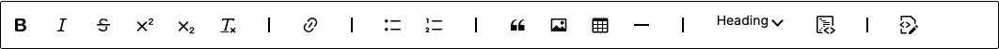
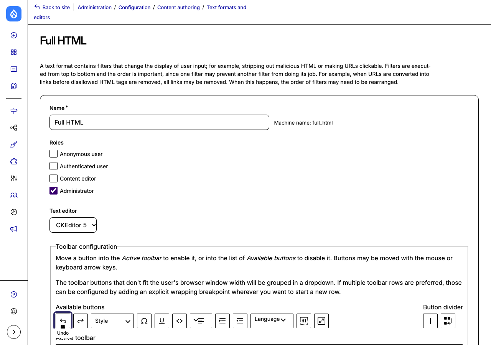

# #3534229 live drupal comparison — [object object] light forced-colors 1280x900

**Run:** `2026-11-27T22-05-39-241Z-chromium-light-forced-1280x900`  
**Configuration:** light OS scheme, forced colors, 1280x900 viewport  
**Comparison:** `3534229-combined-3637246` (#3534229 combined with #3637246 MR !17909: forced-colors mask + dark-mode filter)  
**Verdict recorded by the script:** not-reproduced (a draft; a person has not reviewed it)  
**Core commits:** Before 8a7df6cc3e 2026-11-27, After 8a7df6cc3e 2026-11-27  
**Browser:** chromium 159.0.8154.6, darwin arm64  

**Before and After:** Compatibility evaluation only. Before: pristine pinned core (shared baseline-3534229). After: its own environment issue-3534229-3637246, built with #3637246 MR !17909 (dark-mode filter: invert(1) and --admin-color-bg backgrounds) applied first, then the #3534229 forced-colors mask proposal, which includes a forced-colors filter reset. Confirms the two changes do not invert or obscure the user's forced-colors palette. The #3637246 MR was not modified.

Start with [SUMMARY.md](SUMMARY.md) for the measurements. The pictures below are the same states on both sides: **Before** is the left column, **After** is the right. Click an image to open it full size.

## Images

| State | Before | After |
|---|---|---|
| **active-toolbar** | [](before-active-toolbar.png) | [](after-active-toolbar.png) |
| **available-buttons** | [](before-available-buttons.png) | [](after-available-buttons.png) |
| **fieldset** | [](before-fieldset.png) | [](after-fieldset.png) |
| **focus-bold** | [](before-focus-bold.png) | [](after-focus-bold.png) |
| **focus-undo** | [](before-focus-undo.png) | [](after-focus-undo.png) |

Each image is the full page.

## Files in this folder

| File | What it is |
|---|---|
| `SUMMARY.md` | The run report: verdict, measurements and what was not tested. |
| `results.json` | The same results as data (environment, patch state, per-state measurements). |
| `ajax-before.json / ajax-after.json` | AJAX commands seen on each side during the run. |
| `before-*.png`, `after-*.png` | Screenshots from the unmodified (Before) and patched (After) site. |

## Download

On GitHub, open a file and choose the download button, or clone the repository. To fetch just this folder:

```
git clone --depth 1 --filter=blob:none --sparse https://github.com/mgifford/drupal-core-lab.git
cd drupal-core-lab
git sparse-checkout set reports/issues/3534229/playwright/2026-11-27T22-05-39-241Z-chromium-light-forced-1280x900
```

DRAFT, AI-assisted. Generated by `node scripts/run-readmes.mjs 3534229`; do not edit by hand.
