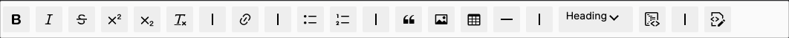
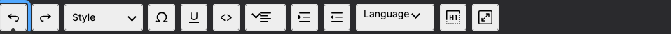
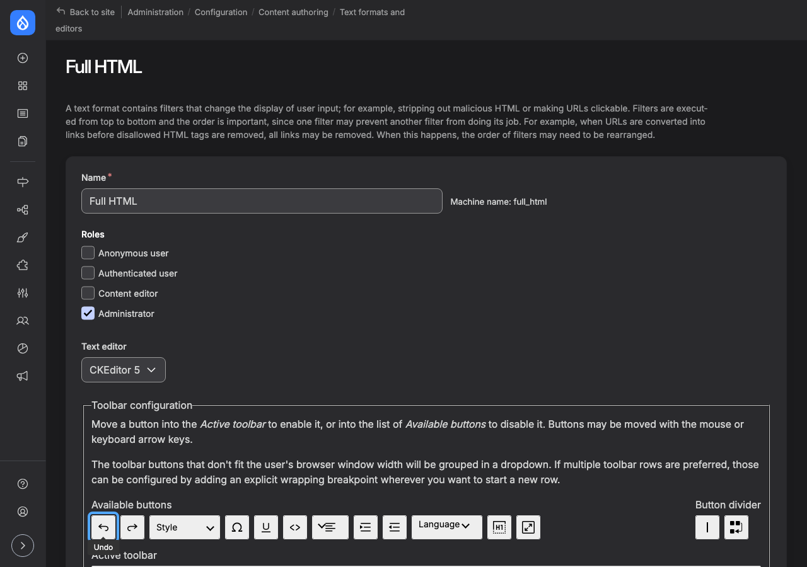

# #3534229 live drupal comparison — [object object] dark 1280x900

**Run:** `2026-11-27T23-23-45-228Z-chromium-dark-1280x900`  
**Configuration:** dark OS scheme, 1280x900 viewport  
**Comparison:** `3534229-pinned` (#3534229: CKEditor 5 toolbar-configuration icons are invisible in forced-colors mode, pinned core)  
**Verdict recorded by the script:** mixed (a draft; a person has not reviewed it)  
**Core commits:** Before 8a7df6cc3e 2026-11-27, After 8a7df6cc3e 2026-11-27  
**Browser:** chromium 159.0.8154.6, darwin arm64  

**Before and After:** Before: upstream core at the pinned commit. After: a local proposal that defines each toolbar icon URL once as a CSS custom property (--ckeditor5-toolbar-icon) and, in forced-colors mode, repaints opted-in icons as a mask in CanvasText. Open /admin/config/content/formats/manage/full_html with forced colours and the dark colour scheme: Before every icon-only control in Available buttons, Button divider and Active toolbar is an empty 36x36 box (black SVG background images on a black Canvas); After the icons are drawn in the user's CanvasText. Heading, Style and Language keep their text labels and carets. The proposed scoping uses a container style query so contributed plugins that only set background-image are unchanged.

Start with [SUMMARY.md](SUMMARY.md) for the measurements. The pictures below are the same states on both sides: **Before** is the left column, **After** is the right. Click an image to open it full size.

## Images

| State | Before | After |
|---|---|---|
| **active-toolbar** | [](before-active-toolbar.png) | [](after-active-toolbar.png) |
| **available-buttons** | [](before-available-buttons.png) | [](after-available-buttons.png) |
| **fieldset** | [](before-fieldset.png) | [](after-fieldset.png) |
| **focus-bold** | [](before-focus-bold.png) | [](after-focus-bold.png) |
| **focus-undo** | [](before-focus-undo.png) | [](after-focus-undo.png) |

Each image is the full page.

## Files in this folder

| File | What it is |
|---|---|
| `SUMMARY.md` | The run report: verdict, measurements and what was not tested. |
| `results.json` | The same results as data (environment, patch state, per-state measurements). |
| `ajax-before.json / ajax-after.json` | AJAX commands seen on each side during the run. |
| `before-*.png`, `after-*.png` | Screenshots from the unmodified (Before) and patched (After) site. |

## Download

On GitHub, open a file and choose the download button, or clone the repository. To fetch just this folder:

```
git clone --depth 1 --filter=blob:none --sparse https://github.com/mgifford/drupal-core-lab.git
cd drupal-core-lab
git sparse-checkout set reports/issues/3534229/playwright/2026-11-27T23-23-45-228Z-chromium-dark-1280x900
```

DRAFT, AI-assisted. Generated by `node scripts/run-readmes.mjs 3534229`; do not edit by hand.
