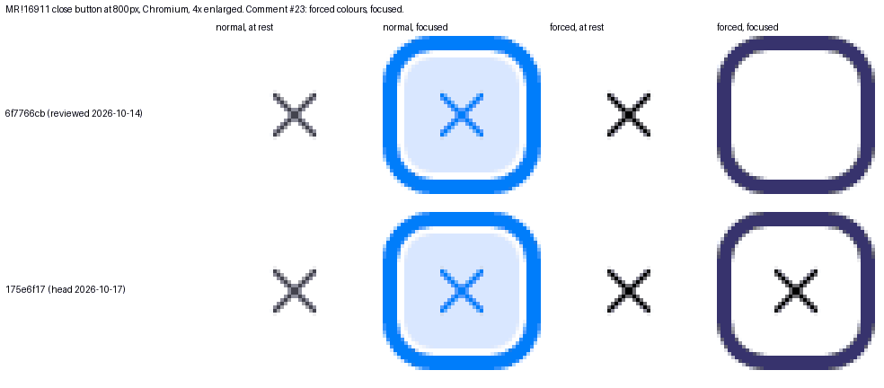

# MR !16911 at 175e6f17: Before/After, 2026-10-18 (scratch environment, not lab evidence)

DRAFT. Not reviewed by a person. Not counted by `scripts/coverage.mjs` (it reads `playwright/` only).

**Result: reproduced-and-fixed in normal and in forced colours.** In forced colours, R12 (comment #23: the close button's
icon when it has focus) passes. With the previous revision `6f7766cb` it failed: 12 icon pixels with focus, now 76 (64 at rest).
Every other row is the same as with `6f7766cb` ([2026-10-17 validation](../2026-10-17-scratch/SUMMARY.md)): the 26 core commits
merged into the branch and the new fix changed nothing else that this scenario measures.

## Conditions

| | |
|---|---|
| Core, both sides | `f2abd4143f87` (main, 2026-10-17 18:19 +0100), the latest commit on the GitHub mirror at the time of the run |
| After | that core plus `branches/sidebar-toggle-fixes.patch` (MR !16911 at `175e6f17`, SHA-256 `317bb661…2942`; see `../../BRANCHES.md` for how it was obtained). The patch applies cleanly; all 23 files of the MR, including the Umami performance-test YAML. |
| Site | Standard install, then `recipes/repro_3619154`; caches rebuilt after the code change. MariaDB 10.11, PHP 8.5 built-in server inside `ddev/ddev-webserver:v1.24.10`. **Not DDEV.** |
| Browser | Chromium 141.0.7390.37 headless, Linux x64, light; once without and once with forced colours (Playwright's `forcedColors: 'active'`, one palette: dark text on a light background). |
| Scenario | `tools/playwright/sidebar-3619154.mjs` through `evaluate-3619154.mjs`, with a shim in place of DDEV in `lib/lab-run.mjs` (`runArgs`, `launch`, `openSide`, `baseResults`); `axeScan`, `writeRun` and its schema check are the real ones. No live-region recording. Narrow width 800px. |

## Forced colours (`results-forced-colors.json`)

12 fix checks: 11 as expected, F11 not applicable on Before. 14 regression checks: all as expected on After. axe: 0 violations on
both sides at all three stages. No JavaScript errors. The normal-colours run (`results.json`) has the same table except O11: After 672 pixels changed by focus
instead of 611, and Before 4 instead of 88 pixels where its close button sits under the top bar.

Fix: should fail Before and pass After. Regression: should pass After. Observed: recorded for a person to judge.

| | Kind | Check | Before | After | Result |
|---|---|---|---|---|---|
| F1 | fix | The toggle is a native `<button>` | false | true | as expected |
| F2 | fix | Space on the focused toggle opens or closes the sidebar | false | true | as expected |
| F3 | fix | The close control is a native `<button>` | false | true | as expected |
| F4 | fix | Below 1024px, the close button is the first focusable element in the open sidebar | false | true | as expected |
| F5 | fix | Below 1024px, opening with Enter moves focus into the sidebar | false | true | as expected |
| F6 | fix | Below 1024px, the page under the overlay is inert while the sidebar is open | false | true | as expected |
| F7 | fix | Below 1024px, 20 Tabs from the open sidebar never reach the covered page | false | true | as expected |
| F8 | fix | Below 1024px, Escape closes the sidebar and returns focus to the toggle | false | true | as expected |
| F9 | fix | First visit below 1024px: the sidebar is never painted on screen while the page loads | false | true | as expected |
| F11 | fix | 1100px, sidebar open and Navigation expanded: opening and closing a details element does not collapse Navigation | n/a | true | not applicable |
| F12 | fix | 1000px: the open sidebar starts at or below the bottom of the bars above it (no overlap) | false | true | as expected |
| F13 | fix | Right to left (dir="rtl" on `<html>`): dragging the handle outward widens the sidebar | false | true | as expected |
| R1 | regression | Mouse click on the toggle closes and reopens the sidebar | true | true | as expected |
| R2 | regression | Enter on the focused toggle opens or closes the sidebar | true | true | as expected |
| R3 | regression | aria-expanded on the toggle matches the sidebar after every desktop action | true | true | as expected |
| R4 | regression | Desktop: a closed sidebar stays closed after reload | true | true | as expected |
| R5 | regression | Desktop: an open sidebar stays open after reload | true | true | as expected |
| R6 | regression | Desktop: dragging the handle changes the width, and the width is kept after reload | true | true | as expected |
| R7 | regression | Below 1024px: a click on the overlay closes the sidebar | true | true | as expected |
| R8 | regression | Below 1024px: the close button closes the sidebar | false | true | as expected (Before also fails) |
| R9 | regression | Below 1024px: the sidebar is closed on load, and after reload | true | true | as expected |
| R10 | regression | Below 1024px: after closing, nothing more is inert than before opening | true | true | as expected |
| R11 | regression | Desktop, closed then reloaded: the sidebar is never painted on screen while the page loads | true | true | as expected |
| R12 | regression | Below 1024px: the close button's icon is drawn at rest and when focused (pixels) | n/a | true | as expected (n/a on Before) |
| R13 | regression | Below 1024px: focus on the close button changes how it looks (focus indicator) | n/a | true | as expected (n/a on Before) |
| R14 | regression | Below 1024px: closing with the overlay or the close button leaves the URL unchanged | true | true | as expected |
| O1 | observe | Toggle in the accessibility tree: open / closed | - button "Hide sidebar panel" [expanded] / - button "Show sidebar panel" | - button "Sidebar panel" [expanded] / - button "Sidebar panel" | recorded |
| O2 | observe | Alt+S toggles the sidebar (keyboard shortcut) | true | false | recorded |
| O3 | observe | Resize handle shown with the sidebar open at 960px / 1000px / 1280px | true / true / true | false / true / true | recorded |
| O4 | observe | Sidebar top minus bottom of the bars above it at 1000px / 1280px (px; negative = overlap) | -49 / 0 | 0 / 0 | recorded |
| O5 | observe | Sidebar top moved after first paint during load at 1280px (range, px) | 64–64 | 64–64 | recorded |
| O6 | observe | Focus after the narrow open / after Escape / after the close button | a.meta-sidebar__trigger / a.visually-hidden / a.meta-sidebar__trigger | button.meta-sidebar__close / button.meta-sidebar__trigger / button.meta-sidebar__trigger | recorded |
| O7 | observe | Where 20 Tabs went from the open narrow sidebar | top-bar 1, covered 8, sidebar 8, close 1, body 1, other 1 | sidebar 13, body 1, other 1, navigation 1, top-bar 2, toggle 1, close 1 | recorded |
| O8 | observe | 1100px: Navigation, sidebar shown (px) before / after opening details / after closing details (html height) | expanded, 0 / expanded, 0 / expanded, 0 (1042→865) | expanded, 320 / expanded, 320 / expanded, 320 (1042→865) | recorded |
| O9 | observe | Below 1024px: what covers the close button (mouse click blocked?) | button.toolbar-button in "Administrative top bar", click blocked | nothing | recorded |
| O10 | observe | 1100px, both stored open, first load: sidebar shown (px) / Navigation | 320 / collapsed | 320 / expanded | recorded |
| O11 | observe | Close button icon pixels at rest / focused, and pixels changed by focus (screenshots `*-close-rest.png`, `*-close-focus.png`) | 88 / not focused / — (covered by button.toolbar-button in "Administrative top bar") | 64 / 76 / 611 | recorded |
| O12 | observe | RTL drag: sidebar side, width before → after dragging outward 120px | left, 480 → 360 | left, 480 → 560 | recorded |

## Still for a person
- **Forced colours by eye**, with a real contrast theme (Windows High Contrast / contrast themes, light and dark) and in Firefox, not
  only Chromium's emulation. The fix sets the focused icon to `canvasText`; a dark palette was not run.
- O2: Alt+S no longer toggles the sidebar. O10: at 1100px a returning user gets the sidebar and an expanded Navigation together.
  Neither is mentioned on the issue page.
- The site without the Navigation module, and Escape shared with Navigation (comment #6).
- A keyboard pass and a screen reader; Firefox and WebKit; dark mode; touch resizing; a right-to-left language install.
