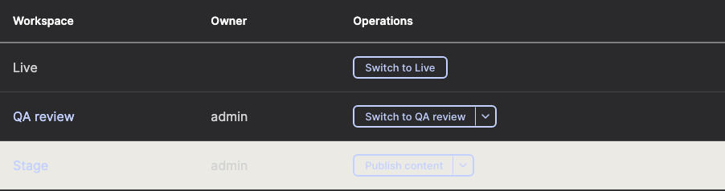
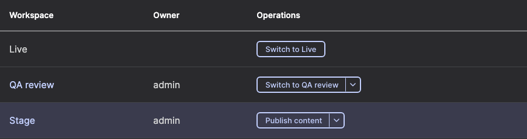
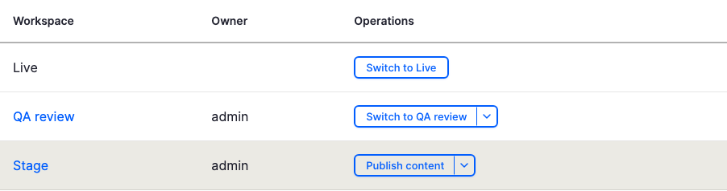
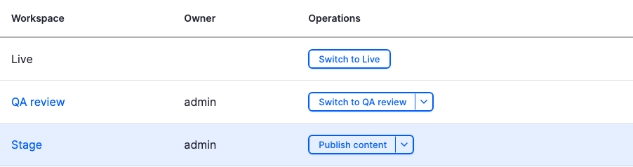

# #3627936: the change, and before and after

DRAFT. Generated from the recorded runs; a person has not reviewed it. There is no merge request for this issue, so this is a fix **written in the lab**
(`branches/3627936-active-workspace-dark-mode.patch`), on core `ad11ba71c0f` (main, 2026-10-15), Default Admin, Chromium 156, 1280x900.

## The change

One rule, in the source stylesheet and its compiled copy (core needs both):

```diff
diff --git a/core/modules/workspaces_ui/css/workspaces.overview.css b/core/modules/workspaces_ui/css/workspaces.overview.css
index 369b0c4fcab9403c0c3959d2f01d7f4af0660646..e8013b3f08b2e6411e2d28b705dfbbca6029f529 100644
--- a/core/modules/workspaces_ui/css/workspaces.overview.css
+++ b/core/modules/workspaces_ui/css/workspaces.overview.css
@@ -12,5 +12,7 @@
 
 /** @todo Move to the admin theme before Workspaces is marked stable. */
 tr.active-workspace {
-  background-color: #ebeae4;
+  /* The admin theme's own item color, which has a dark-mode value. The light
+     fallback keeps the old look in themes that do not define it. */
+  background-color: var(--admin-color-bg-item, #ebeae4);
 }
diff --git a/core/modules/workspaces_ui/css/workspaces.overview.pcss.css b/core/modules/workspaces_ui/css/workspaces.overview.pcss.css
index 78d9feed4c06e326813eda178d6c8120544b8440..e2a7ec6b513d69b1fcfaf42de6b9a700215dcee2 100644
--- a/core/modules/workspaces_ui/css/workspaces.overview.pcss.css
+++ b/core/modules/workspaces_ui/css/workspaces.overview.pcss.css
@@ -5,5 +5,7 @@
 
 /** @todo Move to the admin theme before Workspaces is marked stable. */
 tr.active-workspace {
-  background-color: #ebeae4;
+  /* The admin theme's own item color, which has a dark-mode value. The light
+     fallback keeps the old look in themes that do not define it. */
+  background-color: var(--admin-color-bg-item, #ebeae4);
 }
```

The row takes the admin theme's own item color (the one its hover state already uses, which has a dark-mode value). Themes that do not define it keep the old color.
The patch was changed once after it was first captured (CSpell failed on a spelling in the comment); that is recorded in [PATCH-CHANGES.md](PATCH-CHANGES.md) with the first version kept.

## Dark mode (the reported problem)

| Before | After |
|---|---|
|  |  |

| Measured | Before | After |
|---|---|---|
| Active row background | rgb(235, 234, 228), a light bar | rgb(58, 59, 66), dark |
| Active row text on that background (SC 1.4.3, needs 4.5:1) | **1.24:1** | **7.46:1** |
| Active link on that background | 1.25:1 | 7.41:1 |
| axe violations on the page | 3 | 0 |
| Active row against a row that is not active | 11.87:1 | **1.28:1** |
| Anything other than color that marks the active row | nothing found | nothing found |

**What this shows.** The reported problem reproduces on Before and the patch fixes the legibility. **What it also shows:** with the patch, color alone barely tells the active row from the others
(1.28:1, the figure comment #8 measured for the options it tried), and nothing but color marks it. Whether that is acceptable for this issue, or belongs to #3207233, is a decision for a person.

## Light mode (what must not change)

| Before | After |
|---|---|
|  |  |

The patch **does change the light look**: the active row goes from warm grey rgb(235, 234, 228) to a pale blue, rgb(229, 239, 255), the theme's accent tint. Text contrast stays high (12.89:1 to 13.41:1) and axe finds nothing either way.
Contrast against a row that is not active is 1.21:1 before and 1.16:1 after. The run is marked "mixed" because it was written to expect no change in light mode; whether the new tint is wanted is a design decision.

## Forced colors

Identical on both sides: the active row is indistinguishable from the others (1:1) before and after, and axe reports the same 2 elements on both sides. This is not caused by the patch and is not fixed by it ([run](playwright/2026-10-15T19-55-27-162Z-chromium-dark-forced-1280x900/SUMMARY.md)).

## Not covered

Firefox and WebKit; zoom and reflow; a person looking at the page in dark mode, forced colors and on hover; the pinned core (same commit as latest today). The runs are in `playwright/` (each `SUMMARY.md`, `results.json`) and the lint in `lint/`.
