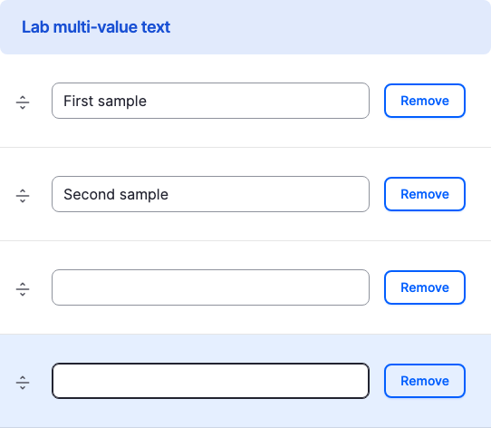
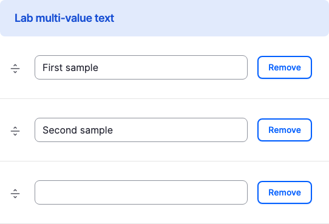

# #3630425 evaluation

**Run:** `2026-11-26T12-56-23-506Z-chromium-light-1280x900`  
**Configuration:** light OS scheme, 1280x900 viewport  
**Comparison:** `3630425-mr17622` (#3630425: MR !17622 on pinned main)  
**Verdict recorded by the script:** reproduced-and-fixed (a draft; a person has not reviewed it)  
**Core commits:** Before dbfce851242 2026-10-16, After dbfce851242 2026-10-16  
**Browser:** chromium 159.0.8154.6, darwin arm64  

**Before and After:** Before: pristine pinned main dbfce851242d with Default Admin and repro_3630425. After: the same core plus MR !17622 head 090a74cd28aa, whose production change is equivalent to !17421 but whose functional assertions are the MR's own (FormTest::testFieldFormUnlimited). This comparison is not a re-run of !17421 or of the Lab's main port, and its results must not be attributed to them. Both touched files are byte-identical at the pin and at the MR base 555acb124a50, so the MR diff applies to the pin. The recipe adds an unlimited core plain-text field named Lab multi-value text with two defaults. Expect no visual change; inspect the header markup, the accessibility tree, the explicit empty-table-header axe rule and screen reader output.

Start with [SUMMARY.md](SUMMARY.md) for the measurements. The pictures below are the same states on both sides: **Before** is the left column, **After** is the right. Click an image to open it full size.

## Images

| State | Before | After |
|---|---|---|
| **add** | [](before-add.png) | [](after-add.png) |
| **initial** | [](before-initial.png) | [](after-initial.png) |
| **remove** | [](before-remove.png) | [](after-remove.png) |

Each image is the full page.

## Files in this folder

| File | What it is |
|---|---|
| `SUMMARY.md` | The run report: verdict, measurements and what was not tested. |
| `results.json` | The same results as data (environment, patch state, per-state measurements). |
| `ajax-before.json / ajax-after.json` | AJAX commands seen on each side during the run. |
| `before-*.png`, `after-*.png` | Screenshots from the unmodified (Before) and patched (After) site. |

## Download

On GitHub, open a file and choose the download button, or clone the repository. To fetch just this folder:

```
git clone --depth 1 --filter=blob:none --sparse https://github.com/mgifford/drupal-core-lab.git
cd drupal-core-lab
git sparse-checkout set reports/issues/3630425/playwright/2026-11-26T12-56-23-506Z-chromium-light-1280x900
```

DRAFT, AI-assisted. Generated by `node scripts/run-readmes.mjs 3630425`; do not edit by hand.
