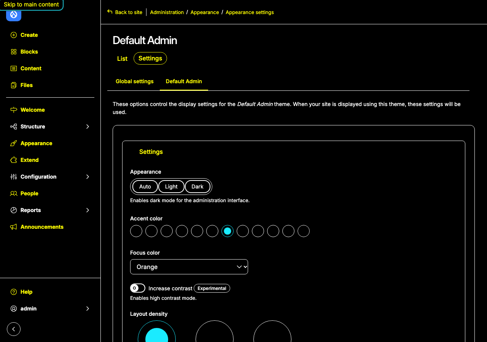
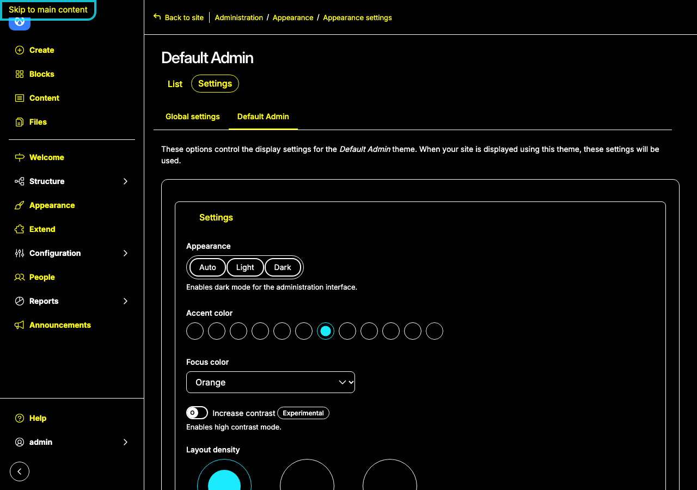
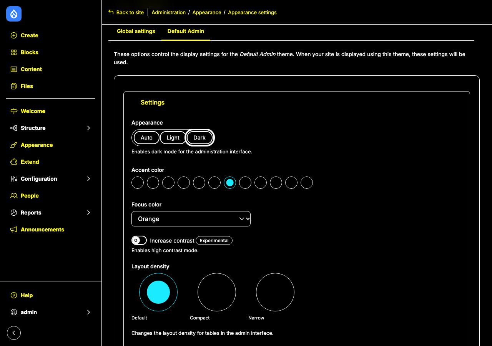
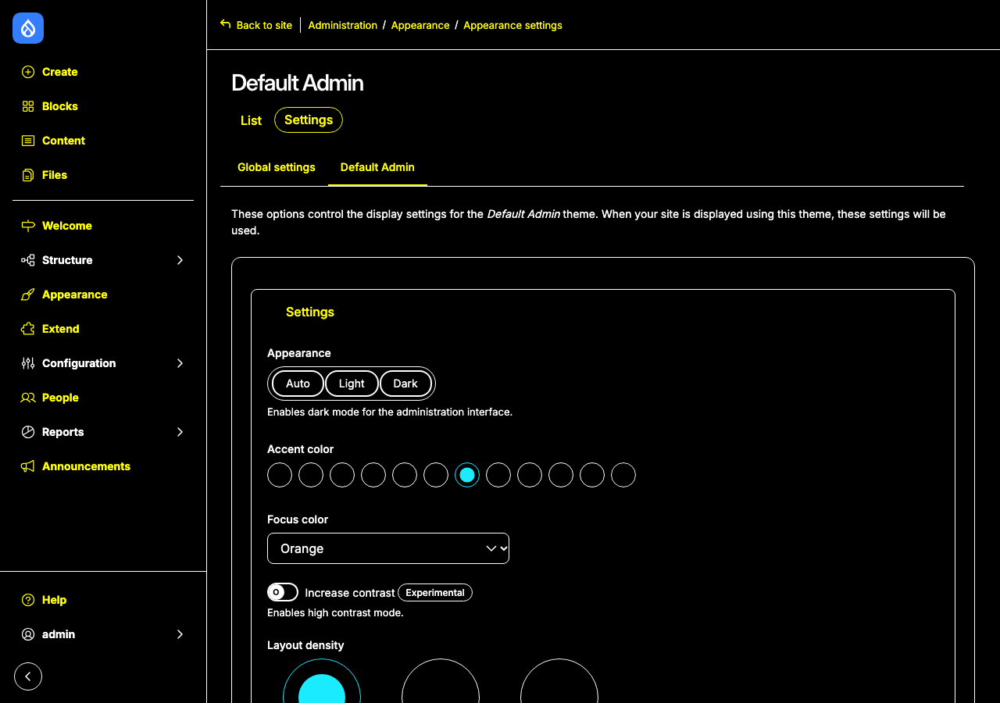
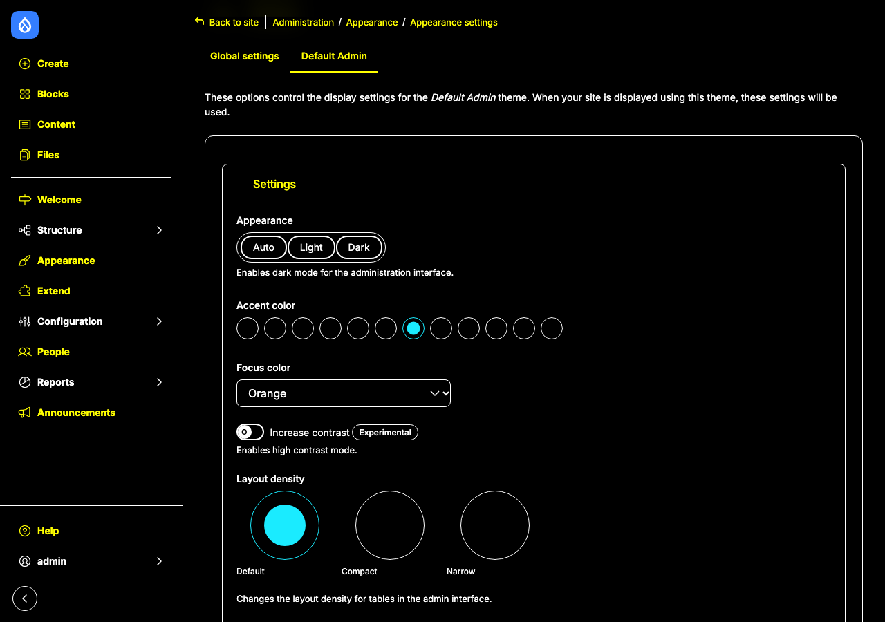

# #3636143 skip link: keyboard focus, saved Appearance and focus colour

**Run:** `2026-11-19T12-23-42-557Z-chromium-dark-forced-1280x900`  
**Configuration:** dark OS scheme, forced colors, 1280x900 viewport  
**Comparison:** `3636143-with-skip-focus` (#3636143: toggle MR with separate #3637339 skip-link proposal)  
**Verdict recorded by the script:** reproduced-and-fixed (a draft; a person has not reviewed it)  
**Core commits:** Before 92e5c3a304 2026-11-18, After 92e5c3a304 2026-11-18  
**Browser:** chromium 156.0.8078.4, darwin arm64  

**Before and After:** Integration comparison only. Before contains navigation-border MR !17738; After adds the separately maintained #3637339 skip-link focus and clearance proposal. This does not revise either upstream MR.

Start with [SUMMARY.md](SUMMARY.md) for the measurements. The pictures below are the same states on both sides: **Before** is the left column, **After** is the right. Click an image to open it full size.

Each group is one saved-settings scenario, named `<Appearance>-<accent>-<focus colour>` (for example `dark-pink-orange` is saved Appearance Dark, Accent Pink, Focus Orange). "Trial 1" and "trial 2" are independent fresh page loads of the same scenario, repeated to show the result is stable.

## dark-pink-orange, trial 1

| State | Before | After |
|---|---|---|
| **before-tab**<br>Page loaded, nothing focused yet. | [](before-dark-pink-orange-trial1-before-tab.png) | [](after-dark-pink-orange-trial1-before-tab.png) |
| **skip-focused**<br>First Tab press: the skip link has focus. | [](before-dark-pink-orange-trial1-skip-focused.png) | [](after-dark-pink-orange-trial1-skip-focused.png) |
| **control-focused**<br>A comparable control has focus (reference for the focus style). | [](before-dark-pink-orange-trial1-control-focused.png) | [](after-dark-pink-orange-trial1-control-focused.png) |
| **activated**<br>Enter pressed on the skip link; focus moves to the main content. | [](before-dark-pink-orange-trial1-activated.png) | [](after-dark-pink-orange-trial1-activated.png) |

## dark-pink-orange, trial 2

| State | Before | After |
|---|---|---|
| **before-tab**<br>Page loaded, nothing focused yet. | [](before-dark-pink-orange-trial2-before-tab.png) | [](after-dark-pink-orange-trial2-before-tab.png) |
| **skip-focused**<br>First Tab press: the skip link has focus. | [](before-dark-pink-orange-trial2-skip-focused.png) | [](after-dark-pink-orange-trial2-skip-focused.png) |
| **control-focused**<br>A comparable control has focus (reference for the focus style). | [](before-dark-pink-orange-trial2-control-focused.png) | [](after-dark-pink-orange-trial2-control-focused.png) |
| **activated**<br>Enter pressed on the skip link; focus moves to the main content. | [](before-dark-pink-orange-trial2-activated.png) | [](after-dark-pink-orange-trial2-activated.png) |

Each image is the full page.

## Files in this folder

| File | What it is |
|---|---|
| `SUMMARY.md` | The run report: verdict, measurements and what was not tested. |
| `results.json` | The same results as data (environment, patch state, per-state measurements). |
| `ajax-before.json / ajax-after.json` | AJAX commands seen on each side during the run. |
| `*-ax.txt` | Accessibility tree text at that moment. |
| `*-axe-full.json` | Full axe-core results at that moment. |
| `before-*.png`, `after-*.png` | Screenshots from the unmodified (Before) and patched (After) site. |

## Download

On GitHub, open a file and choose the download button, or clone the repository. To fetch just this folder:

```
git clone --depth 1 --filter=blob:none --sparse https://github.com/mgifford/drupal-core-lab.git
cd drupal-core-lab
git sparse-checkout set reports/issues/3636143/playwright/2026-11-19T12-23-42-557Z-chromium-dark-forced-1280x900
```

DRAFT, AI-assisted. Generated by `node scripts/run-readmes.mjs 3636143`; do not edit by hand.
