# #3636143 administration navigation toggle: hover, keyboard focus and activation

**Run:** `2026-11-19T15-29-05-094Z-chromium-light-1280x900`  
**Configuration:** light OS scheme, 1280x900 viewport  
**Comparison:** `3636143-latest` (#3636143: same steps against the LATEST core main)  
**Verdict recorded by the script:** reproduced-and-fixed (a draft; a person has not reviewed it)  
**Core commits:** Before 92e5c3a304 2026-11-18, After 92e5c3a304 2026-11-18  
**Browser:** chromium 156.0.8078.4, darwin arm64  

**Before and After:** Before is unmodified current core main (A). After is current core main plus MR !17738 (B, the border colour) plus the lab's separately recorded hover and keyboard-focus enhancement (C: accent border, inner ring, subtle background, external focus outline, forced-colors Highlight). The MR-only comparison (A vs B) is 3636143-pinned.

Start with [SUMMARY.md](SUMMARY.md) for the measurements. The pictures below are the same states on both sides: **Before** is the left column, **After** is the right. Click an image to open it full size.

## Sidebar collapsed

| State | Before | After |
|---|---|---|
| **default**<br>Pointer away, no keyboard focus. | [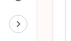](before-default-collapsed-closeup.png) | [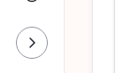](after-default-collapsed-closeup.png) |
| **hover**<br>Real mouse pointer over the toggle. | [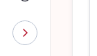](before-hover-collapsed-closeup.png) | [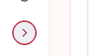](after-hover-collapsed-closeup.png) |
| **focus**<br>Keyboard focus, reached by pressing Tab. | [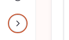](before-focus-collapsed-closeup.png) | [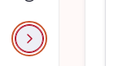](after-focus-collapsed-closeup.png) |
| **focus+hover**<br>Keyboard focus and the pointer over it together. | [](before-focus+hover-collapsed-closeup.png) | [](after-focus+hover-collapsed-closeup.png) |

## Sidebar expanded

| State | Before | After |
|---|---|---|
| **default**<br>Pointer away, no keyboard focus. | [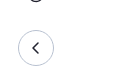](before-default-expanded-closeup.png) | [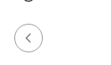](after-default-expanded-closeup.png) |
| **hover**<br>Real mouse pointer over the toggle. | [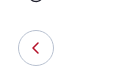](before-hover-expanded-closeup.png) | [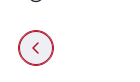](after-hover-expanded-closeup.png) |
| **focus**<br>Keyboard focus, reached by pressing Tab. | [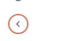](before-focus-expanded-closeup.png) | [](after-focus-expanded-closeup.png) |
| **focus+hover**<br>Keyboard focus and the pointer over it together. | [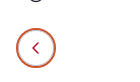](before-focus+hover-expanded-closeup.png) | [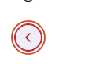](after-focus+hover-expanded-closeup.png) |

Close-up crops are shown; the full-page screenshot has the same name without "-closeup", and carries a label in its top-left corner naming the side (BEFORE or AFTER).

## Files in this folder

| File | What it is |
|---|---|
| `SUMMARY.md` | The run report: verdict, measurements and what was not tested. |
| `results.json` | The same results as data (environment, patch state, per-state measurements). |
| `ajax-before.json / ajax-after.json` | AJAX commands seen on each side during the run. |
| `before-*.png`, `after-*.png` | Screenshots from the unmodified (Before) and patched (After) site. |

## Download

On GitHub, open a file and choose the download button, or clone the repository. To fetch just this folder:

```
git clone --depth 1 --filter=blob:none --sparse https://github.com/mgifford/drupal-core-lab.git
cd drupal-core-lab
git sparse-checkout set reports/issues/3636143/playwright/2026-11-19T15-29-05-094Z-chromium-light-1280x900
```

DRAFT, AI-assisted. Generated by `node scripts/run-readmes.mjs 3636143`; do not edit by hand.
