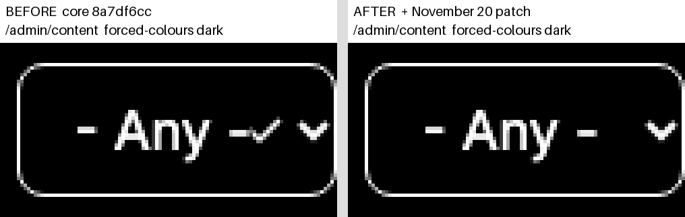

# #3636987: duplicate select caret in forced-colours + dark mode

**DRAFT, AI-assisted. A person has not reviewed this, and nothing was posted to drupal.org.** This is a
Lab comparison of the November 20 patch attached to the issue, not a merge request.

Issue: https://www.drupal.org/project/drupal/issues/3636987
Core under test: `8a7df6cc3e69b6b5d427cb25ce8f66dda8393c29` (current `main`, 2026-11-27), Default Admin,
plain Standard install.

## The problem and the proposed correction

In forced-colours mode with the dark colour scheme, every Default Admin select keeps Drupal's SVG
chevron **and** gets the browser's native caret back through `appearance: revert`, so two chevrons are
drawn. The cause is a specificity conflict: the forced-colours block matches
`.form-element--type-select` (0-1-0) and sets `background-image: none`, but
`.dark-mode .form-element--type-select` (0-2-0) is more specific and keeps the SVG.
Light forced colours, focus and disabled states already resolved to one caret.

The issue's November 20 patch adds `.dark-mode .form-element--type-select` to the existing
`@media (forced-colors: active)` selector list, keeping `background-image: none` and
`appearance: revert`. It changes `form--select.pcss.css` and the compiled `form--select.css`; no
`!important`, no SVG edit, no control redesign. It is imported unchanged
([provenance](BRANCHES.md); sha256 `966db1af…`). The patch still applies to current `main` (three-line
offset in the source, five-line offset in the compiled file).

## Result: reproduced and fixed

| | Before (core `8a7df6cc`) | After (core + patch) |
|---|---|---|
| `/admin/content`, 2 normal selects, forced dark | 2 with Drupal's SVG background + native caret | **0 with the SVG; native caret only** |
| `/admin/structure/block`, 18 extra-small selects, forced dark | 18 with Drupal's SVG background + native caret | **0 with the SVG; native caret only** |
| Same, keyboard focus (real Tab) | 0 (already one caret) | 0 |
| Same, disabled (attribute set in page) | 0 (already one caret) | 0 |
| Same, RTL (simulated with `dir`) | 2 → | 0 |
| Computed `appearance` | `auto` | `auto` |
| `padding-inline-end`, normal / extra-small | 12px / 23px | 12px / 23px (unchanged) |
| Select box, normal / extra-small | 95x40 / 203x28 | 95x40 / 203x28 (unchanged) |
| Forced light, light, dark (controls) | 0, 20, 20 custom backgrounds | 0, 20, 20 (unchanged) |

Before (left) shows two chevrons at the end of the select; After (right) shows one. The extra-small
region selects are the same ([5x crop](screenshots/forced-dark-extrasmall-caret-5x.png)), and the
[full page comparison](screenshots/forced-dark-content-before-after.png) is readable at a glance.

A select shows exactly one caret after the patch because its computed `background-image` is `none` (no
Drupal SVG) and its `appearance` resolves to `auto` (the browser paints its own). The native caret is
UA-painted and cannot be counted from script, so this is the computed property plus the screenshots, not
a programmatic caret count. Every select's recorded values are in the run `SUMMARY.md`/`results.json`
files under [`playwright/`](playwright/README.md).

## Evidence

| What | Where |
|---|---|
| Forced dark 1280 (reproduced and fixed), 480 (same) | [run](playwright/2026-11-27T16-03-06-385Z-chromium-dark-forced-1280x900/SUMMARY.md), [run](playwright/2026-11-27T16-09-06-549Z-chromium-dark-forced-480x900/SUMMARY.md) |
| Forced light, light, dark controls | [forced light](playwright/2026-11-27T16-12-21-219Z-chromium-light-forced-1280x900/SUMMARY.md), [light](playwright/2026-11-27T16-10-29-815Z-chromium-light-1280x900/SUMMARY.md), [dark](playwright/2026-11-27T16-11-09-088Z-chromium-dark-1280x900/SUMMARY.md) |
| Viewer-side comparison (registered `3636987-pinned`, private viewer on 8110) | [manual/README.md](manual/README.md): [forced dark, both frames](manual/viewer-forced-dark-admin-content.png), [5x caret](screenshots/viewer-forced-dark-content-caret-5x.png), [checks table](manual/viewer-forced-dark-admin-content-checks.png), [JSON](viewer-results.json) |
| Matrix and gaps | [COVERAGE.md](COVERAGE.md) (5 of 5 automated environments, no person's manual log) |
| Environments, commits, axe, lint, CSS build, limits | [EVIDENCE.md](EVIDENCE.md) |
| Patch provenance | [BRANCHES.md](BRANCHES.md) |
| Issue state and assignment | [STATUS-2026-11-27.md](STATUS-2026-11-27.md) |
| Reproduce / re-run | [REPRODUCE.md](REPRODUCE.md) |
| Lessons learned (shared viewer state, sandbox, preflight, tooling) | [LESSONS.md](LESSONS.md) |

Generated CSS: core's `build:css --check` **PASS**; running core's `build:css` on the changed source
produced no further diff. Stylelint **PASS**, CSpell **PASS**, PHPStan **PASS**. Core's
`commit-code-check.sh` reports the two CSS files "should not be executable": that is a known false
positive of this build's DDEV `performance_mode: none` bind mount (`test -x` is true for every file,
including a 644 `README.md`), not the patch. Git records 100644 on both sides. See
[EVIDENCE.md](EVIDENCE.md).

## What this establishes, and what it does not

Established: on current `main`, in the Default Admin theme, the defect reproduces in forced-colours
dark mode at 1280 and 480 wide for normal and extra-small selects, both in the scripted runs and in the
registered viewer-side comparison; the November 20 patch removes the custom SVG background in every
forced-colours state while keeping padding, box size and the native `appearance`; the viewer's own checks
fail on Before and pass on After in forced dark; outside forced colours the custom chevron is unchanged;
no axe rule count changed; the compiled CSS is in sync.

Not established: a real Windows High Contrast theme, Firefox/WebKit, a native RTL language, a person's
keyboard pass, a real screen reader, 200% zoom/reflow, or a manual reviewer's sign-off. Forced colours
are emulated by Chromium 159 (Playwright), not Edge or Chromium 144.

## Patch assessment

The correction is minimal and correctly targeted: it wins the specificity contest by matching the
existing resolver rather than adding `!important`, it keeps the two declarations that make the native
caret work, and it does not touch the SVG assets or the select layout. Two things a reviewer may weigh:

- The forced-colours `padding-inline-end` still does not win for extra-small selects (the
  `.no-touchevents .form-element--extrasmall` rule is more specific). This is pre-existing, unchanged by
  the patch, and was 23px on both sides before and after. The fix does not need to address it, but a
  reviewer may want to decide whether the forced-colours padding should be made consistent.
- #3636990 collects several other forced-colours problems in the same settings area (details caret,
  appearance switches, layout-density images). This issue is one item in that list; the patch here does
  not touch those.

## Next

The viewer-side comparison is done: it used a private viewer instance on port 8110 because the shared
one was serving another session's variant, and did not change that session's viewer. In forced-colours
dark the viewer's four checks all behaved as expected on both pages (Before fails the two fix checks,
After passes; padding and appearance unchanged). In forced-colours light the computed fix check passes
on both, so the viewer banner says one check "did not reproduce": that is correct, the defect needs the
dark class.

Still open: a person's manual pass (the viewer's Manual panel, a real keyboard Tab, and optionally a
screen reader), and a person's decision whether to post the draft in
[ISSUE-COMMENT-DRAFT.md](ISSUE-COMMENT-DRAFT.md). No person's viewer log is in `manual/` yet. The
scripted runs and the viewer captures are DRAFT until someone reviews them.

`node scripts/index-issues.mjs` also could not run: it crashes on another session's
`reports/issues/3603162/status.json` (`mr` without `sha`), documented in `docs/WORKSPACE-HYGIENE.md`.
That file belongs to another session and was not edited.

Nothing here is RTBC and no upstream submission was made.
