# #3636987 select caret in forced colors

**Run:** `2026-11-27T16-06-24-672Z-chromium-light-1280x900`  
**Configuration:** light OS scheme, 1280x900 viewport  
**Comparison:** `3636987-pinned` (#3636987: select caret duplicated in forced-colors + dark mode (November 20 patch), core 8a7df6cc3e69)  
**Verdict recorded by the script:** mixed (a draft; a person has not reviewed it)  
**Core commits:** Before 8a7df6cc3e 2026-11-27, After 8a7df6cc3e 2026-11-27  
**Browser:** chromium 159.0.8154.6, darwin arm64  

**Before and After:** Before: pristine core main 8a7df6cc3e69 in a fresh baseline-3636987. After: issue-3636987, same core, plus the November 20 patch (issue attachment 7210257), which adds `.dark-mode .form-element--type-select` to the existing forced-colors selector list. Use the viewer's Conditions > Forced colours Light/Dark; the computed-style checks expect forced colours to be on.

Start with [SUMMARY.md](SUMMARY.md) for the measurements. The pictures below are the same states on both sides: **Before** is the left column, **After** is the right. Click an image to open it full size.

## Images

| State | Before | After |
|---|---|---|
| **block-default-caret** | [](before-block-default-caret.png) | [](after-block-default-caret.png) |
| **block-default-full** | [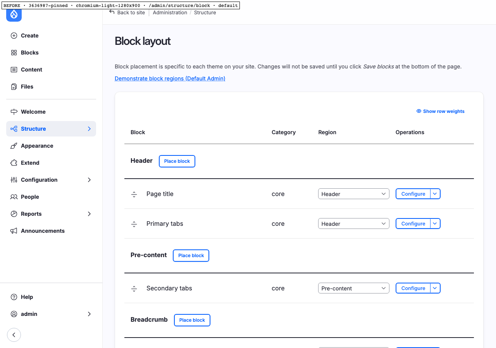](before-block-default-full.png) | [](after-block-default-full.png) |
| **block-disabled-caret** | [](before-block-disabled-caret.png) | [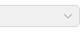](after-block-disabled-caret.png) |
| **block-disabled-full** | [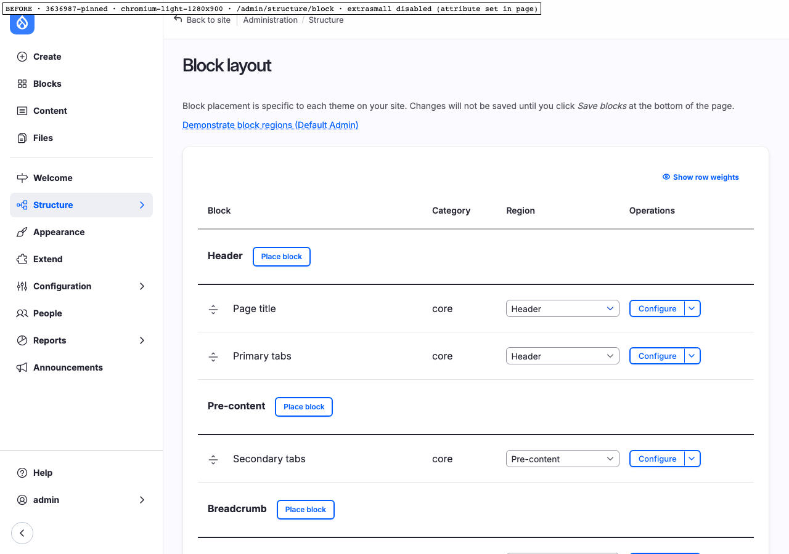](before-block-disabled-full.png) | [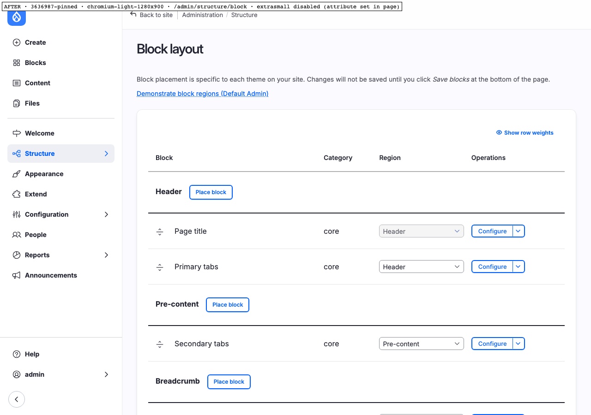](after-block-disabled-full.png) |
| **block-focus-caret** | [](before-block-focus-caret.png) | [](after-block-focus-caret.png) |
| **block-focus-full** | [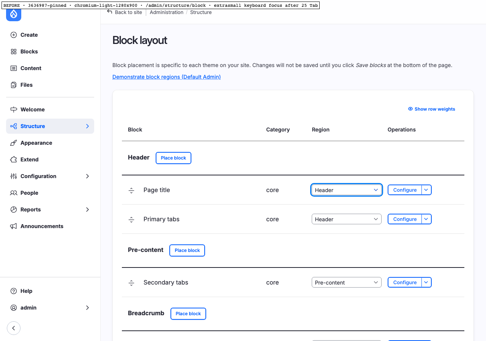](before-block-focus-full.png) | [](after-block-focus-full.png) |
| **content-default-caret** | [](before-content-default-caret.png) | [](after-content-default-caret.png) |
| **content-default-full** | [](before-content-default-full.png) | [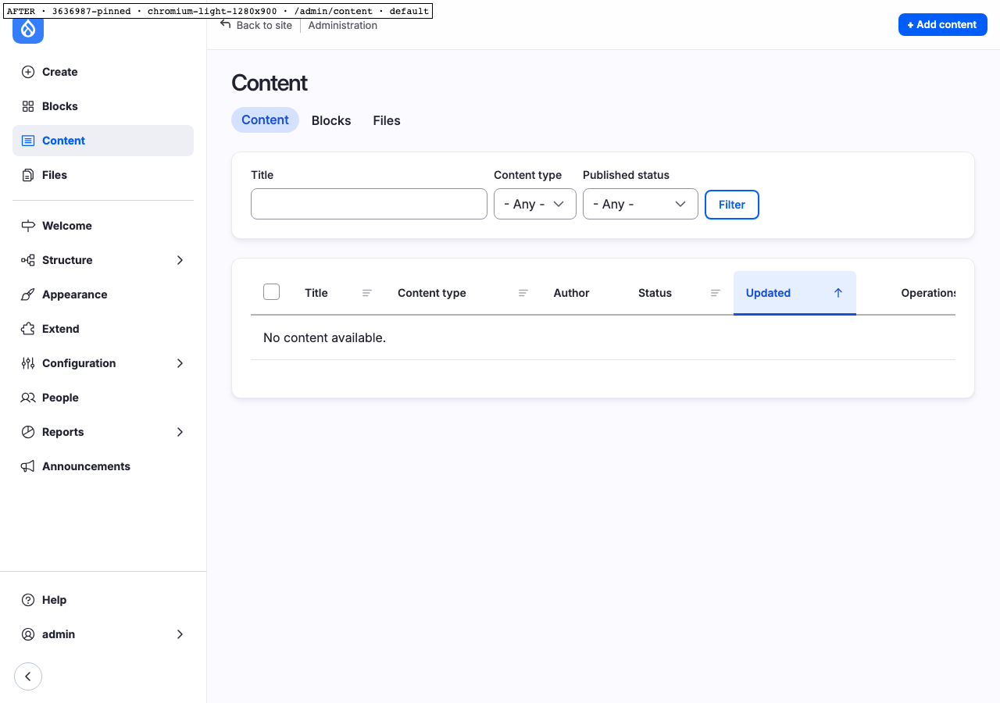](after-content-default-full.png) |
| **content-disabled-caret** | [](before-content-disabled-caret.png) | [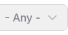](after-content-disabled-caret.png) |
| **content-disabled-full** | [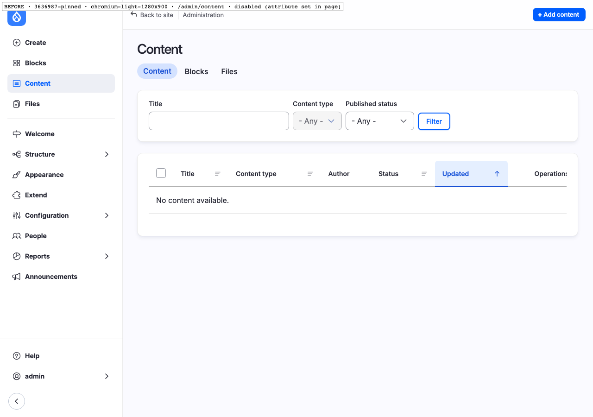](before-content-disabled-full.png) | [](after-content-disabled-full.png) |
| **content-focus-caret** | [](before-content-focus-caret.png) | [](after-content-focus-caret.png) |
| **content-focus-full** | [](before-content-focus-full.png) | [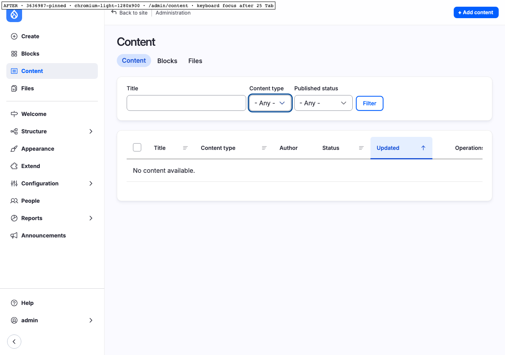](after-content-focus-full.png) |
| **content-rtl-caret** | [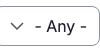](before-content-rtl-caret.png) | [](after-content-rtl-caret.png) |
| **content-rtl-full** | [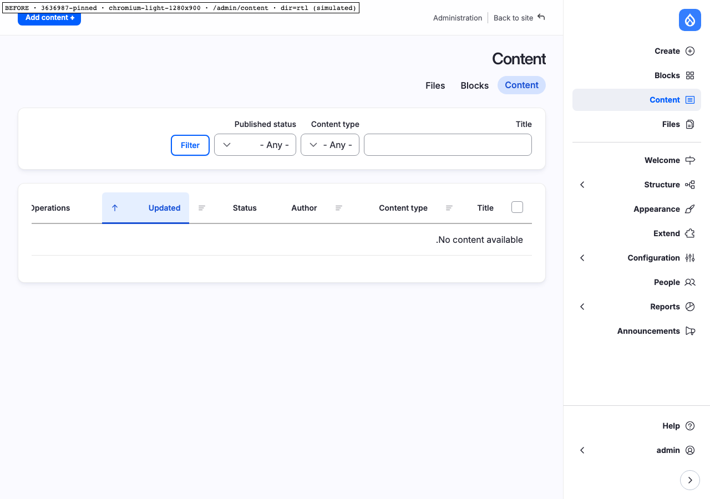](before-content-rtl-full.png) | [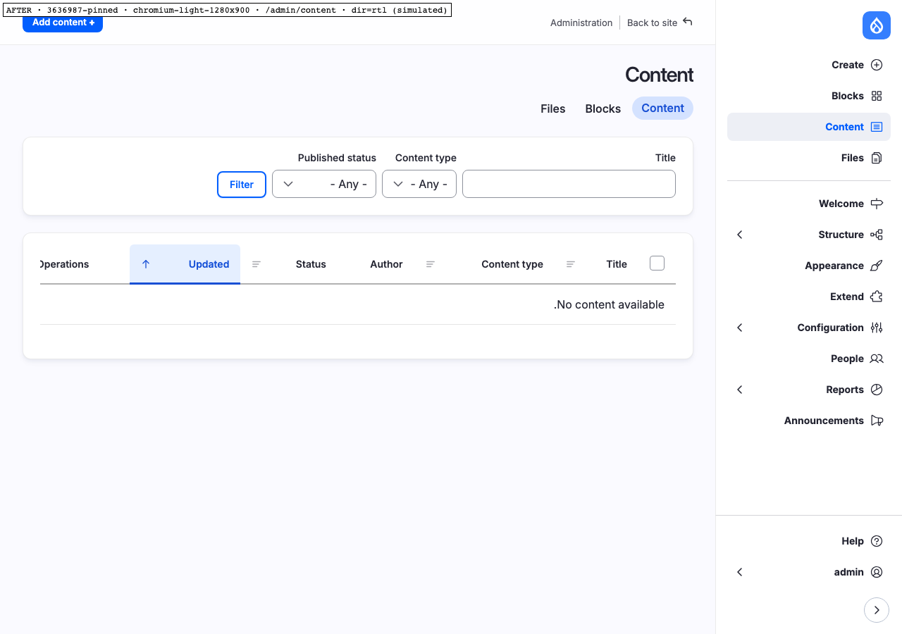](after-content-rtl-full.png) |

Each image is the full page.

## Files in this folder

| File | What it is |
|---|---|
| `SUMMARY.md` | The run report: verdict, measurements and what was not tested. |
| `results.json` | The same results as data (environment, patch state, per-state measurements). |
| `ajax-before.json / ajax-after.json` | AJAX commands seen on each side during the run. |
| `before-*.png`, `after-*.png` | Screenshots from the unmodified (Before) and patched (After) site. |

## Download

On GitHub, open a file and choose the download button, or clone the repository. To fetch just this folder:

```
git clone --depth 1 --filter=blob:none --sparse https://github.com/mgifford/drupal-core-lab.git
cd drupal-core-lab
git sparse-checkout set reports/issues/3636987/playwright/2026-11-27T16-06-24-672Z-chromium-light-1280x900
```

DRAFT, AI-assisted. Generated by `node scripts/run-readmes.mjs 3636987`; do not edit by hand.
