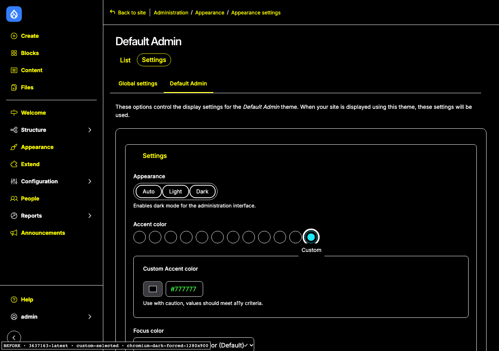
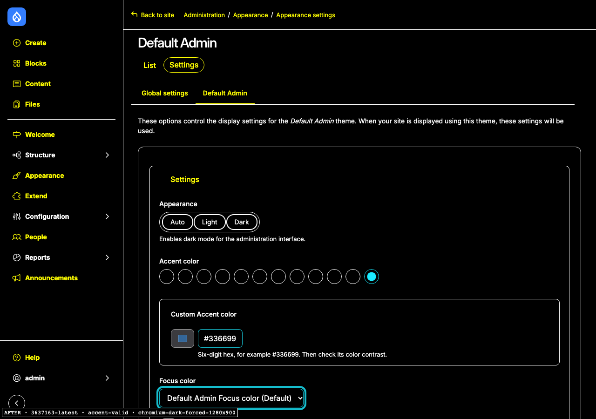
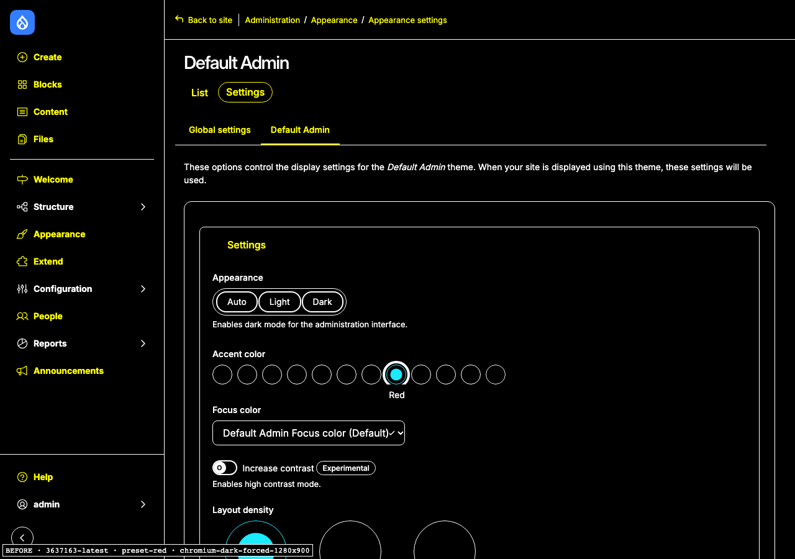
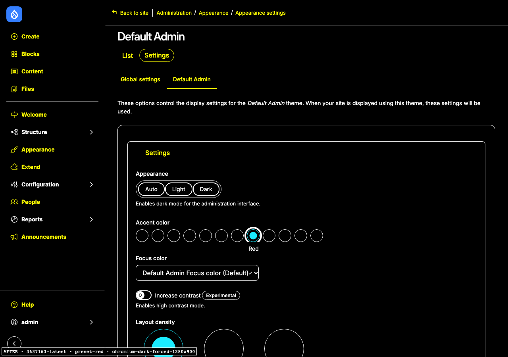
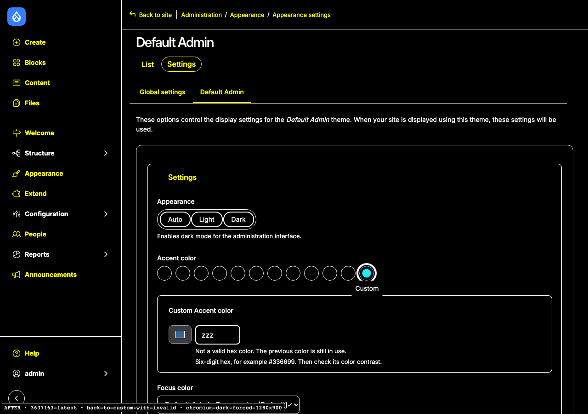
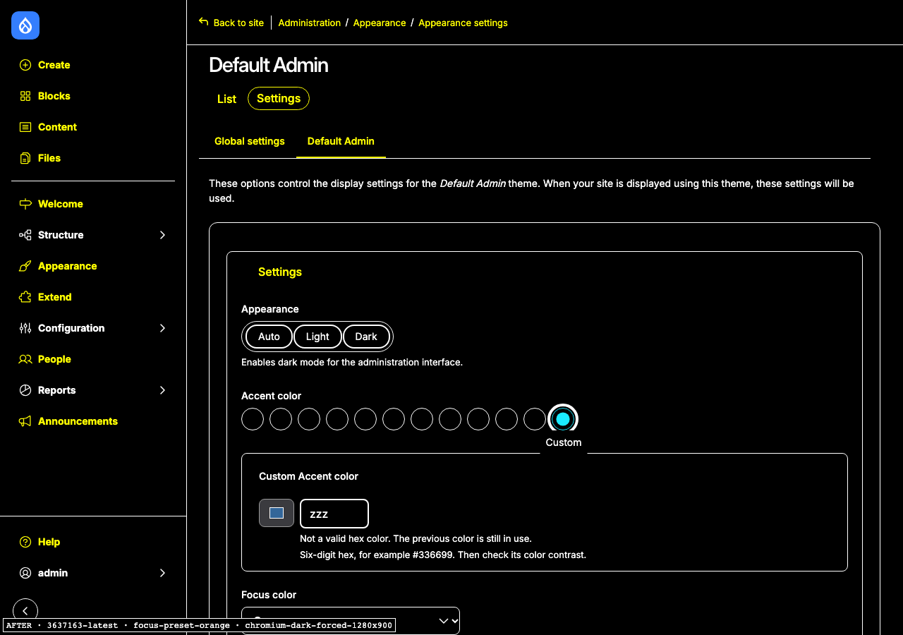
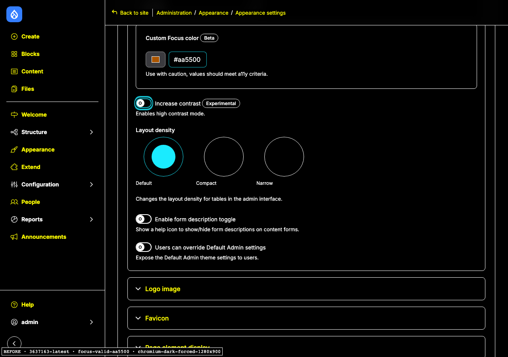
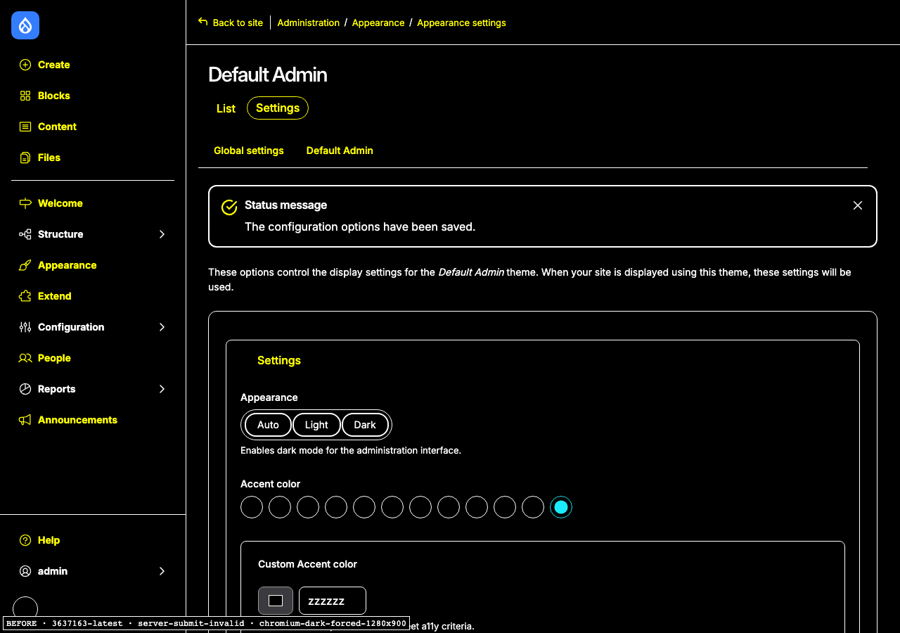

# #3637163 custom colour validation evaluation

**Run:** `2026-11-19T19-32-56-470Z-chromium-dark-forced-1280x900`  
**Configuration:** dark OS scheme, forced colors, 1280x900 viewport  
**Comparison:** `3637163-latest` (#3637163: same steps against the LATEST core main)  
**Verdict recorded by the script:** reproduced-and-fixed (a draft; a person has not reviewed it)  
**Core commits:** Before 92e5c3a304 2026-11-18, After 92e5c3a304 2026-11-18  
**Browser:** chromium 156.0.8078.4, darwin arm64  

Start with [SUMMARY.md](SUMMARY.md) for the measurements. The pictures below are the same states on both sides: **Before** is the left column, **After** is the right. Click an image to open it full size.

## Images

| State | Before | After |
|---|---|---|
| **initial** | [](before-initial.png) | [](after-initial.png) |
| **custom-selected** | [](before-custom-selected.png) | [](after-custom-selected.png) |
| **accent-invalid-777777**<br>Typed: 777777 | [](before-accent-invalid-777777.png) | [](after-accent-invalid-777777.png) |
| **accent-invalid-zzzzzz**<br>Typed: #zzzzzz | [](before-accent-invalid-zzzzzz.png) | [](after-accent-invalid-zzzzzz.png) |
| **accent-valid**<br>Typed: #336699 | [](before-accent-valid.png) | [](after-accent-valid.png) |
| **preset-red** | [](before-preset-red.png) | [](after-preset-red.png) |
| **back-to-custom-with-invalid** | [](before-back-to-custom-with-invalid.png) | [](after-back-to-custom-with-invalid.png) |
| **focus-preset-orange** | [](before-focus-preset-orange.png) | [](after-focus-preset-orange.png) |
| **focus-invalid-abc**<br>Typed: abc | [](before-focus-invalid-abc.png) | [](after-focus-invalid-abc.png) |
| **focus-valid-aa5500**<br>Typed: #aa5500 | [](before-focus-valid-aa5500.png) | [](after-focus-valid-aa5500.png) |
| **server-submit-invalid** | [](before-server-submit-invalid.png) | [](after-server-submit-invalid.png) |

Each image is the full page.

## Files in this folder

| File | What it is |
|---|---|
| `SUMMARY.md` | The run report: verdict, measurements and what was not tested. |
| `results.json` | The same results as data (environment, patch state, per-state measurements). |
| `ajax-before.json / ajax-after.json` | AJAX commands seen on each side during the run. |
| `before-*.png`, `after-*.png` | Screenshots from the unmodified (Before) and patched (After) site. |

## Download

On GitHub, open a file and choose the download button, or clone the repository. To fetch just this folder:

```
git clone --depth 1 --filter=blob:none --sparse https://github.com/mgifford/drupal-core-lab.git
cd drupal-core-lab
git sparse-checkout set reports/issues/3637163/playwright/2026-11-19T19-32-56-470Z-chromium-dark-forced-1280x900
```

DRAFT, AI-assisted. Generated by `node scripts/run-readmes.mjs 3637163`; do not edit by hand.
