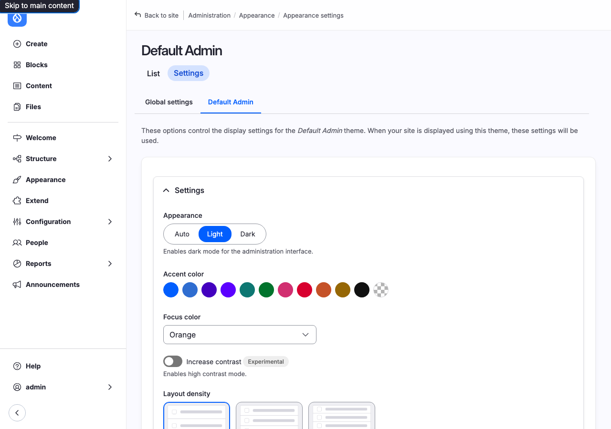
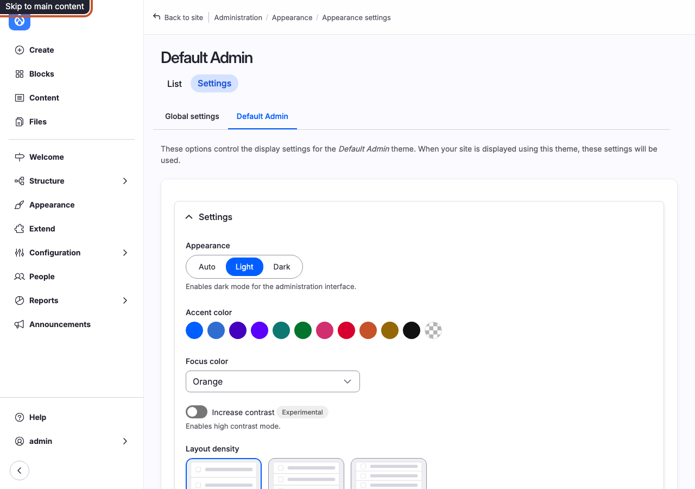

# Evidence: Drupal 3637339

**DRAFT.** Setup, code checks, automated browser measurements and human accessibility review are separate evidence classes.
No conformance or RTBC claim is made.

## Exact comparison identity

| Item | Value |
|---|---|
| Issue | https://www.drupal.org/project/drupal/issues/3637339 |
| MR | https://git.drupalcode.org/project/drupal/-/merge_requests/17818 |
| MR branch | `3637339-skip-to-main` |
| MR head | `8c4a0e703168ebe9c3b37d3a8d00a2e89bc7ffa5` |
| Pinned core | `7480c58b75c058f850b45e81664ac1df7d309744` |
| Latest Before and After core | `ecb483ff6d4b3845fcbc81700843d320c50e46c1` |
| Patch SHA-256 | `d7f7290a5379e7019bc9ec0ed105a9db9763fef2b1dd3544c5cf96e3c312da1c` |
| Before stack | No patches |
| After stack | Only [the unchanged MR](branches/3637339-skip-to-main.patch) |
| Starting state | Plain Standard install, logged-in administrator; no recipe |
| Page | `/admin/appearance/settings/default_admin` |
| Local platform | macOS; Node 24.22.0, Git 2.56.0, Docker 29.9.3, DDEV 1.25.5 |

Both latest sites were built on 2026-11-18 using the registered setup command.
The baseline had no tracked changes after setup. Exact browser versions, settings and timestamps belong to each browser run.
The preceding 3604037 pair was stopped with approval, not reset or deleted.

## Completed setup and code checks

- `doctor.mjs 3637339-latest`: no blocking prerequisites.
- `setup.mjs 3637339-latest --check-patches`: unchanged MR applies to current main.
- `setup.mjs 3637339-pinned --check-patches`: unchanged MR applies to its original base.
- Latest pair setup completed. Viewer health reports HTTP 200 on both sites.
- Pinned pair built and evaluated separately; see the pinned runtime section below.
- [Core lint](lint/2026-11-18-3637339-latest-after.md): PASS on the two changed CSS files.
- [Served HTML/CSS/JS comparison](compare/3637339-latest/SUMMARY.md): both settings pages returned 200;
  2 of 27 comparison items differ. This is not a focus or accessibility result.

## Source review

Read all seven issue comments, the issue summary, MR metadata and the actual two-file diff.
[The intake brief](intake/BRIEF.md) records fetch time and source identities.
Comment #4 proposes the selector-scope explanation; it is a hypothesis to validate against code and browser behavior.
Comment #7 reports dark appearance and Pink with no apparent change, but does not state an independent focus-color option.
Do not conclude the report was a setup error without reproducing both possible configurations.

MR discussions could not be read: GitLab returned HTTP 401. Zero fetched threads does not mean zero review concerns.
The related [migrated Gin issue](https://git.drupalcode.org/project/gin/-/work_items/3506305) summary was read directly;
its original Drupal.org identifier was not found by intake. Gin comments and Gin MR !581 discussions were not retrieved.

## Browser assessment: unchanged MR

The [canonical desktop run](playwright/2026-11-18T19-07-25-161Z-chromium-light-1280x900/SUMMARY.md) used Chromium
`156.0.8078.4`, 1280x900. Each setting was saved through Drupal's UI and tested in two fresh-document trials per side.
Both sites' initial settings were restored through the UI.

| Saved appearance / accent / focus | Before outline | After outline | Color result |
|---|---|---|---|
| Light / Blue (Default) / Orange | Browser blue, 1px auto | `rgb(201, 85, 46)`, 4px solid | Corrected |
| Dark / Blue (Default) / Green | Browser pale blue, 1px auto | `rgb(34, 184, 165)`, 4px solid | Corrected |
| Light / Pink / Same as Accent color | Browser blue, 1px auto | `rgb(209, 47, 112)`, 4px solid | Corrected |
| Dark / Pink / Same as Accent color | Browser pale blue, 1px auto | `lch(88 57.5099 3.4736)`, 4px solid | Corrected |
| Light / Pink / Orange | Browser blue, 1px auto | `rgb(201, 85, 46)`, 4px solid | Corrected |
| Dark / Pink / Orange | Browser pale blue, 1px auto | `rgb(244, 160, 127)`, 4px solid | Corrected |

The After outline matches the comparable focused control in all six configurations and both repeats.
First Tab reaches the skip link; Enter focuses `#main-content` throughout. No axe violations, axe regressions or JavaScript
errors were recorded in this run. This does not establish a general absence of accessibility barriers.

The MR's outline offset is 2px. The focused link remains at top/start 0, so its 4px outline plus offset extends 6px outside
the viewport at the top and inline start. All 12 After trials fail the explicit full-outline-bounds expectation.
This is why the evaluator exits 1 with a mixed verdict even though the color correction passes; it is not an infrastructure error
or an automatic WCAG AA failure. Computed box-shadow was `none` in these captures, not a second painted ring.

### Focused visual evidence

Each screenshot was captured immediately after trusted Tab input in its own document, not by focus mirroring or a CSS simulation.

| State | Before | After |
|---|---|---|
| Light, Orange focus | [Browser-default ring](playwright/2026-11-18T19-07-25-161Z-chromium-light-1280x900/before-light-default-orange-trial1-skip-focused.png) | [Configured orange ring, clipped at top/start](playwright/2026-11-18T19-07-25-161Z-chromium-light-1280x900/after-light-default-orange-trial1-skip-focused.png) |
| Dark, Pink accent with focus Same as Accent | [Browser-default ring](playwright/2026-11-18T19-07-25-161Z-chromium-light-1280x900/before-dark-pink-accent-trial1-skip-focused.png) | [Configured pink ring, clipped at top/start](playwright/2026-11-18T19-07-25-161Z-chromium-light-1280x900/after-dark-pink-accent-trial1-skip-focused.png) |

A model visually inspected four screenshots and observed the color change and clipped top/start portions.
That corroborates the geometric risk but is not a person's visual sign-off. The run summaries retain paint judgment as
inconclusive pending human review. Computed solid-background outline contrast estimates ranged from approximately 4.18:1
to 10.08:1 in this desktop run; those estimates are not composited pixel proof for all adjacent backgrounds.

The following paired captures show the same Light / default accent / Orange focus state, reached independently:

| Before: browser ring | After: configured orange outline |
|---|---|
|  |  |

These are saved screenshots, not simultaneously focused live documents. The live viewer's existing onion/difference modes
operate on documents; no persistent screenshot-comparison mode was added to the viewer.

### Extended matrix and limitations

The following runs used two fresh-document trials per side. All reached After states matched the comparable focus outline and
activated the main-content target. Every unchanged-MR reached After trial still had the viewport-edge bounds problem.

| Environment | Configurations | Evidence |
|---|---|---|
| Chromium, tablet 768px | All six | [Run](playwright/2026-11-18T19-11-30-320Z-chromium-light-768x900/SUMMARY.md) |
| Chromium, mobile 375px | All six | [Run](playwright/2026-11-18T19-12-30-099Z-chromium-light-375x900/SUMMARY.md) |
| Chromium, narrow 480px | All six | [480px run](playwright/2026-11-18T22-51-47-747Z-chromium-light-480x900/SUMMARY.md) |
| Forced light, 1280px | Light/default/Orange | [Run](playwright/2026-11-18T19-13-37-414Z-chromium-light-forced-1280x900/SUMMARY.md) |
| Forced light, 375px | Light/default/Orange | [Run](playwright/2026-11-18T19-13-54-271Z-chromium-light-forced-375x900/SUMMARY.md) |
| Forced dark, 1280px | Dark/Pink/Same as Accent | [Run](playwright/2026-11-18T19-14-08-758Z-chromium-dark-forced-1280x900/SUMMARY.md) |
| Forced dark, 375px | Dark/Pink/Same as Accent | [Run](playwright/2026-11-18T19-14-24-493Z-chromium-dark-forced-375x900/SUMMARY.md) |
| RTL simulation, 1280px | Dark/Pink/Same as Accent | [Run](playwright/2026-11-18T19-14-47-237Z-chromium-light-1280x900/SUMMARY.md) |
| RTL simulation, 375px | Dark/Pink/Same as Accent | [Run](playwright/2026-11-18T19-15-02-745Z-chromium-light-375x900/SUMMARY.md) |
| Firefox, 1280px | Light/Pink/Orange | [Run](playwright/2026-11-18T19-15-16-744Z-firefox-light-1280x900/SUMMARY.md) |
| WebKit, 1280px, explicit Alt+Tab | Light/Pink/Orange | [Run](playwright/2026-11-18T19-17-52-678Z-webkit-light-1280x900/SUMMARY.md) |
| Chromium, OS dark, 1280px | Dark/Pink/Same as Accent | [Run](playwright/2026-11-18T19-16-13-899Z-chromium-dark-1280x900/SUMMARY.md) |
| Pink accent, independent Default focus | Light and Dark | [Diagnostic](playwright/2026-11-18T19-16-29-782Z-chromium-light-1280x900/SUMMARY.md) |

In forced dark, the After outline resolved to a system-style `rgba(26, 235, 255, 0.8)`, matching the comparable focused control,
not the configured author Pink. This is expected under forced colors. It does not justify adding an untested `Highlight` override.
The positioning problem remains separate from the system-color substitution.

The [plain-Tab WebKit attempt](playwright/2026-11-18T19-15-43-522Z-webkit-light-1280x900/SUMMARY.md) skipped the link on both sides.
Its historical product-failure wording is inconclusive for the MR; it is not evidence that the MR caused a keyboard regression.
The explicit Alt+Tab run demonstrates alternate link-navigation behavior, not a plain-Tab pass or a full Safari test.

The two Pink/default-focus diagnostics produced blue focus (`rgb(0,125,250)` Light, `rgb(81,168,255)` Dark), not Pink.
This confirms the settings distinction, without determining what the November 17 reviewer selected.

Across the canonical desktop and these 14 additional runs: 36 configuration/environment combinations, 144 trials and zero
infrastructure errors, JavaScript errors or detected axe count increases. There were 78 accumulated axe violation-node occurrences
of `target-size` and forced-dark `color-contrast`, already present in the compared states, not 78 unique defects.
The plain-Tab WebKit attempt contributes four incomplete trials, not passing color or activation evidence.
Full axe JSON is retained locally, including incomplete checks; detector counts are not conformance outcomes.
The original desktop run had zero violations, but that must not be generalized to the broader matrix.

Large raw results and full scans remain under this issue's local timestamped evidence directories; they have not been committed
or published. The 19:04 calibration run is retained and marked superseded by the canonical 19:07 desktop run.
The GitHub package includes run summaries and their linked screenshots, not raw results, full scans or accessibility-tree dumps.
The coverage ledger is a saved snapshot; regenerating it requires the local `results.json` files or new evaluator runs.

### Root-cause trace at core `ecb483ff6d4b`

- `core/themes/default_admin/templates/html.html.twig:48-52` renders the skip link before the page.
- `core/themes/default_admin/templates/system/off-canvas-page-wrapper.html.twig:23` wraps page content in `.page-wrapper`.
- `core/themes/default_admin/css/base/elements.pcss.css:244-247` scopes general focus styling to page-wrapper/dialog content;
  the skip link is outside it. The MR supplies the missing outline declarations for the skip link.
- `core/themes/default_admin/src/Settings.php:294-304` exposes focus choices separately from accent choices.
  Pink is an accent choice, not a focus preset. Pink focus requires **Same as Accent color** when Pink is the selected accent.
- `core/themes/default_admin/css/theme/accent.pcss.css:33-50` resolves the selected focus token.
- `core/themes/default_admin/css/components/skip-link.pcss.css:12-13` leaves the link at zero top/start.
- `core/themes/default_admin/css/_variables/variables-misc.pcss.css:18-20` defines the 4px outline and 2px offset.

The color defect is therefore reproduced and corrected by the MR in this measured matrix. The viewport-edge clipping is a
separate remaining concern. The smallest justified experiment is token-derived clearance at block start and inline start
while focused, retaining the MR outline and existing keyboard behavior. Any such experiment must be a separate patch and comparison.

The November 17 comment does not record enough configuration to establish its cause retrospectively.
Selecting Pink accent alone is not sufficient to request Pink focus; do not dismiss the report as tester error.

## Pinned runtime verification

The original-base pair was built at `7480c58b75c058f850b45e81664ac1df7d309744` and tested independently.
The [six-configuration Chromium desktop run](playwright/2026-11-18T22-45-11-940Z-chromium-light-1280x900/SUMMARY.md)
records 24 trials: the baseline mismatches the configured outline in all six configurations; the unchanged MR matches it in all six.
Enter activation and the measured paired navigation/geometry checks pass. All 12 After trials retain the outline-bounds problem,
so exit 1 and the mixed verdict are expected. No axe violations, JavaScript errors or infrastructure errors were recorded.

The [pinned plain-Tab WebKit diagnostic](playwright/2026-11-18T22-46-09-583Z-webkit-light-1280x900/SUMMARY.md) again fails to reach
the link on both sides. Color, activation and geometry comparisons are null/inconclusive, not product failures.
The finalized evaluator exits 2 for incomplete comparisons; it no longer returns a product-failure or success exit for these states.
Both pinned runs restored settings. Pinned non-desktop, forced-colors, RTL and alternate-key WebKit cases were not run.

## Separate experimental clearance comparison

The registered `3637339-focus-clearance` comparison uses the same current core on both sides.
Before contains the unchanged MR; After adds only the [captured clearance interdiff](branches/3637339-focus-clearance.patch).
The [complete revised patch](branches/3637339-focus-clearance-full.patch) is the alternative artifact for clean current core.
Exact hashes, starting trees and four successful packaging checks are in [BRANCHES.md](BRANCHES.md).
[Core lint passes](lint/2026-11-18-3637339-focus-clearance-after.md) on both changed CSS files.

| Environment | Configurations | Evidence |
|---|---|---|
| Chromium, desktop 1280px | All six | [Desktop experiment](playwright/2026-11-18T21-14-42-901Z-chromium-light-1280x900/SUMMARY.md) |
| Chromium, mobile 375px | All six | [Mobile experiment](playwright/2026-11-18T21-15-36-779Z-chromium-light-375x900/SUMMARY.md) |
| RTL simulation, 375px | Dark/Pink/Same as Accent | [RTL experiment](playwright/2026-11-18T21-39-18-244Z-chromium-light-375x900/SUMMARY.md) |
| Forced light, 375px | Light/default/Orange | [Mobile forced-light experiment](playwright/2026-11-18T21-39-32-189Z-chromium-light-forced-375x900/SUMMARY.md) |
| Forced dark, 375px | Dark/Pink/Same as Accent | [Mobile forced-dark experiment](playwright/2026-11-18T21-39-44-025Z-chromium-dark-forced-375x900/SUMMARY.md) |
| Forced light, 1280px | Light/default/Orange | [Desktop forced-light experiment](playwright/2026-11-18T21-39-55-791Z-chromium-light-forced-1280x900/SUMMARY.md) |
| Forced dark, 1280px | Dark/Pink/Same as Accent | [Desktop forced-dark experiment](playwright/2026-11-18T21-40-07-963Z-chromium-dark-forced-1280x900/SUMMARY.md) |
| Firefox 157.0, 1280px | Light/Pink/Orange | [Firefox experiment](playwright/2026-11-18T21-49-35-048Z-firefox-light-1280x900/SUMMARY.md) |
| WebKit 27.2, 1280px, explicit Alt+Tab | Light/Pink/Orange | [Qualified WebKit experiment](playwright/2026-11-18T21-49-56-521Z-webkit-light-1280x900/SUMMARY.md) |

Across these nine runs, 19 configuration/environment combinations and 76 trials:

- The configured/comparable outline remains matched in every After trial.
- The full-outline viewport bounds change from out of bounds to inside on every comparison.
- In LTR Chromium, the link moves from x=0, y=0 to x=6, y=6 without changing size.
  At RTL 375px, its right edge moves from 375 to 369 and top from 0 to 6.
- Enter reaches `#main-content`. Paired focus sequences, activation scroll, skip-link size and comparable-control rectangles
  remain equal within the declared 0.5 CSS px geometry tolerance.
- No infrastructure errors, JavaScript errors, measured layout/navigation regressions or axe count increases were detected.
  The 54 accumulated axe violation-node occurrences are retained separately; they are not 54 unique defects or proof of conformance.
  The comparison checks rule/node-count increases; equal counts cannot exclude changed affected elements.
- Every run records restoration of both sites' initial settings through the UI.

A model inspected the experimental desktop Light/Orange and mobile Dark/Pink focused screenshots.
Both show the previously missing top/start ring portions within the viewport. This is limited visual corroboration, not a
human sign-off or pixel-by-pixel contrast assessment.

| MR-only focused state | MR plus clearance focused state |
|---|---|
| [Desktop Light/Orange before](playwright/2026-11-18T21-14-42-901Z-chromium-light-1280x900/before-light-default-orange-trial1-skip-focused.png) | [Desktop Light/Orange after](playwright/2026-11-18T21-14-42-901Z-chromium-light-1280x900/after-light-default-orange-trial1-skip-focused.png) |
| [Mobile Dark/Pink before](playwright/2026-11-18T21-15-36-779Z-chromium-light-375x900/before-dark-pink-accent-trial1-skip-focused.png) | [Mobile Dark/Pink after](playwright/2026-11-18T21-15-36-779Z-chromium-light-375x900/after-dark-pink-accent-trial1-skip-focused.png) |

The experiment is supported for these measured conditions, not every browser/configuration combination.
The experimental patch is not part of upstream MR !17818. The evaluator's generated paint judgments remain inconclusive
until human review; this report records the narrower model-inspection observation separately.

## Human review and scope limits

- No human keyboard pass or real VoiceOver/NVDA evaluation has been performed.
- No evaluation with disabled participants has been performed.
- Browser-emulated forced colors are not actual Windows High Contrast testing.
- Computed styles and element geometry alone cannot establish that the painted focus indicator is fully visible.
- Automated scans do not determine whether every focus indicator meets WCAG.
- Focus Appearance, SC 2.4.13, is AAA. It must not be reported as an AA requirement.

## Final lab validation

- [Repository selftest](selftest.txt): nine groups pass, none skipped. This includes 231 lab-tool tests, 157 issue-pack tests,
  36 design-observation tests, 61 registered variants, documentation references, generated cloud metadata and 14 skill checks.
- Focused `tests/lab/run-record.test.mjs`: 11 tests pass, including the regression proving an experiment cannot fill or replace
  the pinned-core coverage column. Experimental evidence remains under Other runs with its comparison slug.
- All 28 retained `results.json` files pass the shared run schema. This includes calibration and diagnostic runs; it is not
  a claim that every run is complete or that every measured expectation passes.
- The [comment draft](ISSUE-COMMENT-DRAFT.md) passes the form/disclosure checker at 175 words. Human rewriting is still required.
- The generated latest-core Coder prompt is current. No separate experimental prompt overwrote the canonical latest-core handoff.
- Both pristine baseline checkouts remain free of tracked changes. The upstream patch hash and both local patch hashes match
  [BRANCHES.md](BRANCHES.md); all four packaging checks were repeated successfully.
- Before stopping the latest pair, the registered viewer's health endpoint confirmed HTTP 200 on both sites.

The local evidence directory is about 352 MiB, including full raw scans and intermediate captures. Nothing was staged or published.
Do not blanket-stage this directory: select reviewable reports and captures separately from large raw results.
No token, GPU-energy or carbon instrumentation ran for this assessment; retrospective resource totals are unknown.

## Provenance

AI-assisted: Copilot SDK in VS Code assisted intake, assessment tooling and draft documentation.
The official MR remains unchanged and is attributed in [BRANCHES.md](BRANCHES.md).
Evidence is local and DRAFT; nothing has been posted to Drupal.org, pushed, or published for this issue.
